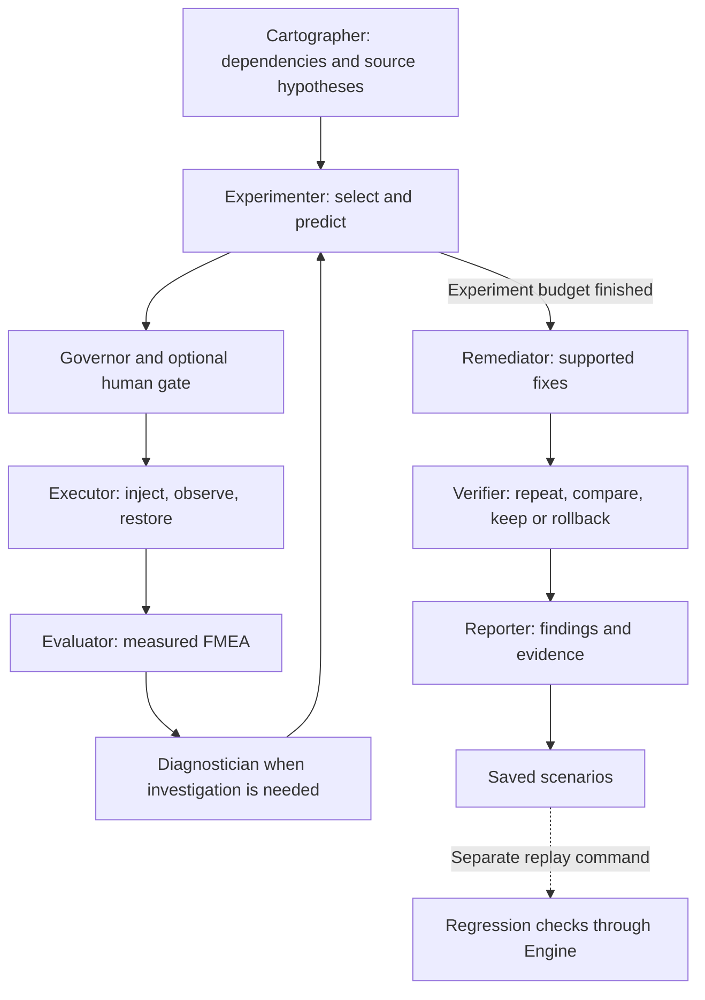

# ChaosPilot

**Controlled failures. Measured outcomes. Verified fixes. Repeatable checks.**

Repository: [arthambansal/bosch_hack](https://github.com/arthambansal/bosch_hack)

ChaosPilot investigates resilience in an isolated Docker application.<br>
It maps service dependencies and proposes experiments with reasons and predictions.<br>
Deterministic safety controls govern fault injection, monitoring and restoration.<br>
Agents diagnose failures and select supported fixes, which are checked by repeating experiments.<br>
Reports rank measured weaknesses and preserve qualifying failures as regression scenarios.

## Contents

- [Capabilities and architecture](#capabilities-and-architecture)
- [Team 7 and contributions](#team-7-and-contributions)
- [Fresh-clone setup](#fresh-clone-setup)
- [Run the full application](#run-the-full-application)
- [Mystery Mode and regression replay](#mystery-mode-and-regression-replay)
- [Safety and scoring](#safety-and-scoring)
- [Results and evidence](#results-and-evidence)
- [Development and validation](#development-and-validation)
- [Repository layout](#repository-layout)
- [Troubleshooting](#troubleshooting)
- [License and attribution](#license-and-attribution)

## Capabilities and architecture

The demonstration target is Docker's Example Voting App:

```text
Vote (Flask) -> Redis queue -> Worker (.NET) -> PostgreSQL -> Result (Node.js)
```

ChaosPilot uses Python and LangGraph for orchestration, a React/Vite Control Room,
and Python's built-in HTTP server for local dashboard/API hosting. The engine
controls the sandbox through Docker. LLM requests use the configured API provider.



The graph can investigate additional experiments and retry eligible remediation
within its configured limits. The diagram summarizes responsibilities; see
[the architecture](docs/ARCHITECTURE.md) and [graph wiring](agentic/graph.py).

| Capability | What it does |
|---|---|
| Source-aware Cartographer | Uses confined read-only source tools, checks citations and retains rule fallbacks; hypotheses remain unproven until tested. |
| Adaptive Experimenter | Selects from ranked candidates, explains predictions and targets coverage of three fault types when budget and policy permit. |
| Five fault mechanisms | Kill, pause, network partition, latency and traffic spike; available live behavior depends on Docker/helper prerequisites. |
| Observer and Truth Oracle | Collect probes, logs and container events; track canary delivery and disagreements between monitoring and actual invariants. |
| Diagnosis and memory | Explain evidence, retrieve confirmed failure patterns and support blind diagnosis. |
| Mystery Mode | Hide the injected fault from diagnosis, reveal the answer and record trial outcomes, including wrong answers. |
| Fix verification | Apply supported sandbox fixes, repeat targeted experiments and record per-fix outcomes, untested cases and rollback failures. Code patches remain suggestions. |
| Reporting | Deterministic FMEA and score, timing coverage, impact, executive summary, postmortems, fault tree, heatmap and evidence references. |
| Never Again | Export qualifying failures and replay saved scenarios against measured invariants. |
| Control Room | Live agents, approvals, STOP, truth, plans, predictions, fixes, memory, history and presentation views; optional Discord notifications. |

Dashboard History's **Recorded Event Replay** plays saved log lines for review.
Regression replay actually injects a saved fault in the sandbox. They are different actions.

## Team 7 and contributions

Responsibilities below follow [PROJECT_BLUEPRINT Section 20.2](docs/PROJECT_BLUEPRINT.md)
and the updated [Day 2 ownership contract](docs/day2/DAY2_CONTRACT.md).
[TEAM_PLAN.md](TEAM_PLAN.md) is superseded by the blueprint. Ownership describes
the team's implementation scope; it does not assert live validation of every feature.

| Participant | Day 1 responsibilities | Day 2 contributions / scope | Main code areas |
|---|---|---|---|
| **Artham Bansal** - lead and integration | Experimenter, LangGraph orchestration, Governor, Executor, fault injection, scoring integration and shared interfaces | Mystery harness, fault coverage, ranked-plan publication, verification/rollback, prediction and Truth Oracle wiring, shared contracts and integration; audit trail optional | `agentic/graph.py`, `agentic/runtime.py`, `agentic/state.py`, `agentic/nodes/experimenter.py`, `governor.py`, `execute.py`, `core/engine.py`, `core/faults.py`, `core/agent.py`, `core/mystery.py`, `core/contract_v5.py`, `chaospilot.py` |
| **Pratham Dobhal** - observation and remediation | Observer, probes, discovery, Remediator, supported fix catalog and sandbox configuration | Truth Oracle, fix descriptions, proposed code patches, PostgreSQL failure analysis and fault validation | `core/observer.py`, `core/probes.py`, `core/discover.py`, `core/truth.py`, `core/heal.py`, `core/patches.py`, `agentic/nodes/remediator.py`, `sandbox/fixes/`, `sandbox/patches/` |
| **Dipen Batharaju** - diagnosis and memory | Diagnostician, evidence tools, SQLite Knowledge Store and failure signatures | Blind diagnosis, memory-first diagnosis/retrieval, Mystery trial evaluation and accuracy reporting | `agentic/nodes/diagnostician.py`, `core/knowledge.py`, `core/signatures.py`, `core/analysis_tools.py`, `core/tools.py` |
| **Samridhi Dhamija** - Control Room and notifications | Dashboard, operator approvals, STOP controls and notification/briefing scope | Control Room v2, Mystery and history API/UI, fix and truth panels, recorded event playback, presentation mode and Discord alerts | `dashboard/`, `core/notify.py` |
| **Tejas Bhargava** - source analysis, reporting and regression | Cartographer, bounded source tools, Reporter, timing/summary/visual report additions and documentation | More flexible citation-validated hypotheses, report v2 impact/scorecard/postmortems, scenario export/replay, restricted manual CI, measured result-pause scenario, findings and documentation | `agentic/nodes/cartographer.py`, `core/code_tools.py`, `agentic/nodes/reporter.py`, `core/report_extras.py`, `core/regression.py`, `scenarios/`, `.github/workflows/resilience.yml`, `README.md`, owned `docs/` files |

Day 2 assigns the Mystery harness to Artham and blind diagnosis/evaluation to
Dipen, updating the earlier blueprint split. Only Artham changes shared contracts,
state/runtime, CLI and configuration. Tejas's documentation ownership excludes the
shared Day 2 contract. Teammates work on their own branches; Artham integrates into
`main`. Team form and video are separate deliverables, not implied complete here.

## Fresh-clone setup

Prerequisites: Git, Python 3.10+ (3.11 recommended), Docker Desktop/Engine with
Compose v2 and Linux containers, and Node.js 20.19+ or 22.12+ for the dashboard.
Keep ports 8000, 8080 and 8081 available. Run one orchestrator per workspace and
avoid simultaneous checkouts controlling the same `chaos-*` containers.

### Windows PowerShell

```powershell
git clone https://github.com/arthambansal/bosch_hack.git
cd bosch_hack
python -m venv .venv
.\.venv\Scripts\Activate.ps1
python -m pip install -r requirements.txt
docker info
docker compose version
docker pull nicolaka/netshoot
git clone https://github.com/dockersamples/example-voting-app sandbox/app-src
cd dashboard
npm ci
npm run build
cd ..
```

### macOS / Linux

```bash
git clone https://github.com/arthambansal/bosch_hack.git
cd bosch_hack
python3 -m venv .venv
source .venv/bin/activate
python -m pip install -r requirements.txt
docker info
docker compose version
docker pull nicolaka/netshoot
git clone https://github.com/dockersamples/example-voting-app sandbox/app-src
cd dashboard
npm ci
npm run build
cd ..
```

Cloning uses the repository's default branch. For Tejas branch-specific work, run
`git switch tejas` after cloning. The nested application source is gitignored and
enables source inspection; runtime containers use the images defined by Compose.
A source checkout is not proof that those images were built from that exact commit.

### Configure AI through environment variables

The current client uses `OPENAI_API_KEY` for Groq's OpenAI-compatible endpoint;
setting `GROQ_API_KEY` alone does not configure this client. Supply your own key
only in your shell, never in source, `.env`, screenshots or commits.

PowerShell (masked prompt):

```powershell
$groqCredential = Read-Host 'Groq API key' -AsSecureString
$env:OPENAI_API_KEY = [System.Net.NetworkCredential]::new('', $groqCredential).Password
Remove-Variable groqCredential
$env:LLM_PROVIDER = 'openai'
$env:OPENAI_BASE_URL = 'https://api.groq.com/openai/v1'
$env:LLM_MODEL = 'openai/gpt-oss-120b'
$env:LLM_AGENT_MODEL = 'openai/gpt-oss-20b'
```

Bash:

```bash
read -rsp 'Groq API key: ' OPENAI_API_KEY
export OPENAI_API_KEY
export LLM_PROVIDER=openai
export OPENAI_BASE_URL=https://api.groq.com/openai/v1
export LLM_MODEL=openai/gpt-oss-120b
export LLM_AGENT_MODEL=openai/gpt-oss-20b
```

Model names are the project's configuration examples; use models available to your
provider account. Without configured credentials, supported paths use rule fallbacks.
`--offline` avoids live LLM calls and can use cached responses or rules/memory,
depending on the agent. It still runs real Docker faults. A fresh clone has no cache.
Optional alerts read `DISCORD_WEBHOOK_URL` from the environment; never commit its value.

## Run the full application

Start Docker first. In an activated terminal at the repository root:

```powershell
python chaospilot.py up
docker compose -f sandbox/docker-compose.yml ps
python chaospilot.py map
python chaospilot.py baseline --seconds 15
```

Wait until the vote and result pages respond before mapping/baselining:

- Vote: http://localhost:8080
- Results: http://localhost:8081

In **terminal 2**, open the same repository, activate its environment and run:

```powershell
python chaospilot.py dashboard
```

Open http://127.0.0.1:8000. This command keeps that terminal occupied. Build the
dashboard first as above; an absent build may show a minimal fallback page.
For frontend development/proxy instructions see [dashboard/README.md](dashboard/README.md).

Back in **terminal 1**:

```powershell
python chaospilot.py autopilot --max 5 --approve
```

Review any approval in the terminal or dashboard. `--approve` enables the normal
autopilot human gate for combined faults; it does not mean auto-approve everything.
After experiments, remediation and verification run unless `--no-heal` is supplied.
Reporter prints the generated report location.

Useful variants:

```powershell
python chaospilot.py autopilot --max 5 --approve --no-heal
python chaospilot.py autopilot --max 5 --approve --offline
python chaospilot.py autopilot --max 5 --approve --goal "What happens when the queue is unavailable?"
python chaospilot.py --help
```

### Stop and restore

Use the dashboard STOP control, or create the root STOP file:

```powershell
New-Item -ItemType File -Path STOP -Force
```

On POSIX: `touch STOP`. STOP is checked throughout the pipeline and approval waits.
For explicit restoration:

```powershell
python chaospilot.py panic
docker compose -f sandbox/docker-compose.yml ps
```

Check actual cleanup/container state before restarting. Remove the STOP file only
after inspecting the stop reason, completing cleanup and deliberately starting a
new run (`Remove-Item -LiteralPath STOP` on PowerShell, `rm STOP` on POSIX).
Once no run is active, stop the sandbox with
`docker compose -f sandbox/docker-compose.yml down` (no volume-deletion flag).

## Mystery Mode and regression replay

Run these separately after autopilot finishes, with the sandbox mapped/baselined:

```powershell
python chaospilot.py mystery --trials 3
```

For a judge selecting a hidden fault through the dashboard:

```powershell
python chaospilot.py mystery --wait
```

Truth Oracle runs alongside execution when available. Mystery hides fault labels
from diagnosis until reveal; report trial count, wrong answers and failed injections
alongside accuracy. See [Mystery results](docs/day2/MYSTERY_RESULTS.md).

### Never Again

Reporter exports qualifying confirmed failures with measured windows and evidence.
Review the saved scenario and its invariants before replay:

```powershell
python chaospilot.py replay --scenario scenarios/result-pause-ci.json
```

`python chaospilot.py replay` selects all saved scenarios. Replay uses the production
Engine, enforces safety/approval checks and evaluates recovery/delivery invariants.
Combined and data-store scenarios require local human approval. Missing required
measurements cannot silently pass. A failed replay returns a nonzero exit code.

**Verification** repeats experiments immediately after a fix. **Regression replay**
is a separate later command checking saved conditions against the current sandbox.
Replay does not select new AI experiments or automatically fix a failure. See
[scenario guidance](scenarios/README.md).

### GitHub Actions

[Resilience regression](.github/workflows/resilience.yml) is **manual**
(`workflow_dispatch`). Open Actions, select Resilience regression, choose the branch
and Run workflow. It runs offline checks, selects eligible single worker/result
kill/pause scenarios, starts a base sandbox and replays those scenarios. It skips
combined/data-store files and fails if no eligible scenario exists or a replay fails.
It uploads artifacts and attempts sandbox cleanup even on failure.

The saved result-pause scenario is based on 0.6s measured recovery and 32/32 delivered
votes, with a 5s recovery limit. This local measurement is not evidence of a passing
GitHub-hosted run; verify the actual Actions result before claiming CI success.

## Safety and scoring

Safety is code-enforced: configured sandbox targets and Compose identity checks,
at most two fault steps, and at most one stateful service disrupted. Guard watches
configured error/latency ceilings, consecutive breach ticks and duration. STOP and
restoration paths remain active. Autopilot's combined-fault gate requires `--approve`;
replay separately gates combined/data-store cases. Do not describe all single
data-store autopilot experiments as automatically human-gated.

Source tools are read-only and bounded. AI proposals are validated; supported
fallbacks keep missing AI output explicit. Code patch suggestions remain proposed.
A failed rollback is reported as still applied with `rollback_failed`, not as a
successful undo. See [contracts](CONTRACT.md) and [Day 2 details](docs/day2/DAY2_CONTRACT.md).

FMEA assigns each experiment **RPN = Severity x Occurrence x Detection**. Severity
and detection use recorded outcomes; occurrence is a stated fault-type prior.
Higher detection values mean harder to detect. RPN ranges from 1 to 1000.

The Reporter sorts RPNs descending and computes:

```text
penalty = (0.50*RPN1 + 0.25*RPN2 + 0.15*RPN3 + 0.10*RPN4) / 10
score   = max(0, round(100 - penalty))
```

Only the four highest RPNs contribute. Missing positions contribute zero; weights
are not redistributed. Grades: A >=90, B >=80, C >=70, D >=60, otherwise F.
Example: RPNs 630, 270, 70 give 61/100. This is an experiment-specific summary,
not availability percentage or proof of universal reliability. Verification scores
describe retests; rolled-back results do not describe the retained configuration.

## Results and evidence

| Recorded case | Observation | Qualification |
|---|---|---|
| Approved Day 1 Redis kill | 24 accepted / 24 delivered; 1.5s HTTP recovery; RPN 98 | That trial did not reproduce a stuck worker; see [preserved evidence](docs/evidence/e1/). |
| `auto_20261010_170117`, Redis pause | RPN 270 -> 30 | Improvement in one retest, not a general reliability guarantee. |
| Same run, PostgreSQL kill | RPN 630 -> 700 | Fix did not resolve risk; see [E3 analysis](docs/day2/E3_ANALYSIS.md). |
| `auto_20261010_225230`, combined worker/Redis kill | 40 accepted / 24 delivered; recorded deficit 16 | Aggregate audit, not proof of permanent per-ID loss. |
| Local result pause | 32/32 delivered; 0.6s recovery; no stuck services | Source of the measured CI-safe scenario, not hosted CI proof. |

Read [FINDINGS.md](docs/FINDINGS.md), [validation notes](docs/VALIDATION.md) and
[Mystery evaluation](docs/day2/MYSTERY_RESULTS.md) for scope and limitations.
Original source folders may be local archives; preserve the matching run artifacts
when sharing results. Mock tests and dashboard fixtures are simulated data. Missing
truth/timing measurements remain unknown. Small Mystery samples, cached/rule paths
and live LLM calls must be identified separately. Golden-run/video completion is not
established by the existence of code or a script.

Generated files usually include:

| Location | Contents |
|---|---|
| `dependencies.json`, `baseline.json` | Discovered topology and healthy reference measurements |
| `runs/auto_*/results.json`, `events.log` | Measured experiments and execution timeline |
| `runs/auto_*/fmea.json`, `verification.json` | Risk ranking and retests when produced |
| `runs/auto_*/report.md`, `report.html` | Final or partial report |
| `runs/live_state.json` | Dashboard snapshot |
| `runs/mystery_trials.jsonl` | Mystery trial history |
| `scenarios/*.json` | Reviewed saved experiments |
| `runs/replay_*/replay.json` | Replay outcome/evidence |

## Development and validation

Run offline checks with no live pipeline using the same workspace; mock graph tests
write generated state/run artifacts. They do not validate real Docker behavior.

```powershell
python tests/test_contract_v5.py
python tests/test_graph_mock.py
python tests/test_regression.py
python tests/test_report_v2.py
```

Contract and graph checks are required before pushing by the team contract. Additional
focused tests cover truth, diagnosis, memory, patches, coverage, lifecycle and safety
under `tests/`. For dashboard changes:

```powershell
python -B -m unittest discover -s dashboard/tests -p "test_*.py" -v
cd dashboard
node --test tests/*.test.js
npm run build
cd ..
git diff --check
```

Review `git status` and stage exact owned files. Keep API keys, `.env`, webhook URLs,
local environments, source clones and generated run data out of commits unless
specific sanitized evidence has been reviewed for publication. Some generated
root files may already be tracked: inspect their diff rather than staging blindly.
Never change shared state/schema signatures without coordinating with Artham.

## Repository layout

```text
chaospilot.py              CLI entry point
config.json               Sandbox services, probes and limits
agentic/                  LangGraph state, runtime, gates and agent nodes
core/                     Engine, faults, probes, truth, diagnosis tools, fixes, scoring, replay
dashboard/                React/Vite UI, Python server and frontend/backend checks
sandbox/                  Docker Compose, supported fixes and patch suggestions
  app-src/                Ignored upstream source clone
scenarios/                Saved replay scenarios
tests/                    Offline contract and feature checks
docs/                     Blueprint, architecture, findings, validation and evidence
  day2/                   Shared Day 2 contract, handoffs and evaluation notes
runs/                     Generated state, logs, caches and reports (ignored)
.github/workflows/        Manual resilience regression workflow
LICENSE                   Apache-2.0 license terms
```

## Troubleshooting

| Symptom | What to check |
|---|---|
| Docker connection/permission error | Start Docker Desktop with Linux containers; require `docker info` to show its Server section in the same terminal. |
| Empty or unavailable baseline | Wait for both app pages, rerun `map`, then `baseline`; do not use stale measurements from another configuration. |
| Minimal/old dashboard | Run `npm ci` and `npm run build` under `dashboard/`, then restart the Python dashboard server. |
| PowerShell activation blocked | Use `.\.venv\Scripts\python.exe` instead of `python`; or enable scripts only for that terminal with `Set-ExecutionPolicy -Scope Process -ExecutionPolicy RemoteSigned`. |
| Missing LangGraph | Install requirements using the same virtual-environment Python that runs ChaosPilot. |
| AI uses fallback | Check provider/key environment in that process and logs for rate limits or validation rejection. Do not print or share secret values. |
| Latency fault not injected | Confirm the configured netem helper image is pulled and supported by Docker; failed injection is not a successful fault test. |
| Approval expired / HTTP 409 | Refresh state and inspect the current gate; old approval tokens cannot approve a new experiment. |
| STOP prevents a new run | Inspect stop reason and cleanup, then intentionally clear the root STOP file before restarting. |
| Git cannot resolve GitHub | Repair network/DNS access and retry; force-push does not solve connectivity errors. |

## License and attribution

ChaosPilot is distributed under [Apache-2.0](LICENSE). The sandbox application is
the [Docker Samples Example Voting App](https://github.com/dockersamples/example-voting-app),
also under Apache-2.0. Credit belongs to its original authors; retain upstream
copyright, license and any applicable notices when redistributing its code.
Third-party dependencies retain their own licenses.
