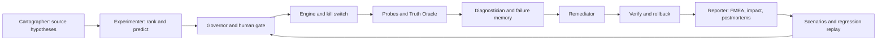

# ChaosPilot

Repository: https://github.com/arthambansal/bosch_hack

The isolated Docker voting app is exercised by controlled faults.
Cartographer proposes source-cited weaknesses for experiments.
Governor and approval gates constrain every destructive action.
Observers measure errors, recovery, delivery, and data loss.
Reporter turns evidence into scores, findings, and replayable scenarios.

This project is licensed under Apache-2.0. The sandbox voting application is
the Docker Samples Example Voting App, licensed under Apache-2.0; see
`sandbox/app-src` and its upstream repository for its original notices.

## Four proofs

| Proof | Mechanism | Evidence in this repo |
|---|---|---|
| Truth Oracle | Unique canary votes compared with stored votes (gray failures) | `core/truth.py`, `tests/test_truth.py`; live golden run pending |
| Blind mystery diagnosis | Hidden injection, evidence-only guess, reveal, accuracy history | `docs/day2/MYSTERY_RESULTS.md` (small samples, failures kept) |
| Fix with proof and rollback | Re-run after a fix, per-fix verdict from the RPN comparison, automatic undo | `auto_20261010_170117/verification.json`, `docs/day2/E3_ANALYSIS.md` |
| Never again | Confirmed failure exported as a scenario, replayed with invariant checks | `scenarios/`, `tests/test_regression.py` |

## Quick start from a fresh clone (macOS / Linux)

Needs Git, Docker Desktop (with Compose), Python 3.10+ and Node 20.19+ (for the dashboard).

```bash
git clone https://github.com/arthambansal/bosch_hack.git
cd bosch_hack
python3 -m venv .venv && source .venv/bin/activate
pip install -r requirements.txt
docker pull nicolaka/netshoot                   # helper image for the latency fault
(cd dashboard && npm ci && npm run build)       # builds the Control Room once
# optional: lets the Cartographer read the app's source code
git clone https://github.com/dockersamples/example-voting-app sandbox/app-src
```

AI models (Groq, OpenAI-compatible API). Set these in your shell only; never put the key in a file or a commit:

```bash
export OPENAI_API_KEY="your-groq-key"
export OPENAI_BASE_URL="https://api.groq.com/openai/v1"
export LLM_MODEL="openai/gpt-oss-120b"          # Experimenter, Remediator, Reporter
export LLM_AGENT_MODEL="openai/gpt-oss-20b"     # tool-using Cartographer and Diagnostician
```

Without a key every agent falls back to its deterministic rules, and `--offline` replays the last saved AI answers
from `runs/llm_cache`. On Windows PowerShell use `.\.venv\Scripts\Activate.ps1` and `$env:OPENAI_API_KEY = "..."`.

Checks (no Docker needed):

```bash
for t in tests/test_*.py; do PYTHONPATH=. python3 "$t" || break; done
```

Live run on the isolated sandbox (two terminals):

```bash
python3 chaospilot.py up                        # start the voting app (Docker Compose)
python3 chaospilot.py map                       # discover services and dependencies
python3 chaospilot.py baseline --seconds 15     # normal error rate and latency
python3 chaospilot.py dashboard                 # terminal 2: open http://127.0.0.1:8000
python3 chaospilot.py autopilot --max 5 --approve
python3 chaospilot.py mystery --trials 3        # hidden faults, blind diagnosis
```

Stop everything at any time: dashboard Emergency stop, or `touch STOP`, or `python3 chaospilot.py panic`.

Reports are written under `runs/auto_*/report.md` and `report.html`. Baseline comes
before faults. Obtain human approval for data-store disruption; the main pipeline
Governor currently gates combined faults, while the replay implementation also gates
data-store disruption. Create `STOP` or use the dashboard STOP to halt injection.

## Never-again replay

Reporter exports only confirmed failures with measured fault windows and at least
two investigation evidence quotes. Inspect `scenarios/*.json` before committing.
Missing measurements fail checks rather than silently passing. No failed scenario
is fabricated from the successful Day 1 E1 run.

To explicitly restore the base configuration before a weakness demonstration (on
your isolated sandbox, with no other active run):

```powershell
docker compose -f sandbox/docker-compose.yml up -d --force-recreate
python chaospilot.py map
python chaospilot.py baseline --seconds 15
python chaospilot.py replay --scenario scenarios/<actual-exported-id>.json
```

A reproduced weakness returns exit code 1. After an approved fix, replay against the
fixed configuration and require PASS. `python chaospilot.py replay` runs all saved
scenarios with the current CLI; the requested positional path / `--all` parser change
is documented for Artham in `docs/day2/TEJAS_HANDOFF.md`. No AI is used during replay.

The workflow `.github/workflows/resilience.yml` is manually triggered in GitHub
Actions. It selects single worker/result kill/pause scenarios in a fresh base
sandbox and skips combined or data-store scenarios, which retain local human
approval. It fails if no CI-safe scenario exists or a selected replay fails.
The measured CI-safe scenario `scenarios/result-pause-ci.json` records 0.6s recovery,
32/32 delivered votes, and no stuck items. Runner reliability is still unverified,
so the workflow remains manual.
**The workflow has not been observed passing on GitHub; live chaos CI is not claimed.**

## Architecture



Details and ownership boundaries: `docs/ARCHITECTURE.md` and
`docs/day2/DAY2_CONTRACT.md`.

## Safety and scoring

Targets must be configured sandbox services and carry the matching Compose project
label. Limits: at most two faults, at most one data store down; runtime guard checks
errors, p95 latency, blast radius, STOP and maximum duration. Restoration and traffic
shutdown run on replay failure too. Source tools are confined/read-only; hypotheses
remain open until experimental evidence supports them. Code patches are suggestions.
FMEA S/O/D and RPN come from code, never an LLM; the resilience score is deterministic
and applies to the experiments observed, not a universal reliability guarantee.

## Results and honest limits

Real run `auto_20261010_170117` (files in the repo root folder of that name; summary in `docs/FINDINGS.md`):

| Finding | Measurement |
|---|---|
| Resilience score | 61/100 (grade D) before fixes |
| Worker crash after a Redis pause (E2) | RPN 270 -> 30 after the restart-policy fix (verified) |
| Postgres kill (E3) | RPN 630 -> 700: the generic fix did not help; see `docs/day2/E3_ANALYSIS.md` |

The score covers only the experiments that were run, not a guarantee for the whole system. Mystery accuracy is
measured on small samples and reported with every wrong answer (`docs/day2/MYSTERY_RESULTS.md`). Mock tests are
simulations and are never cited as live results.

## Team

Artham: orchestration, Governor, mystery and verification. Pratham: probes, Truth
Oracle and remediation. Dipen: diagnosis and failure memory. Samridhi: Control Room
and notifications. Tejas: Cartographer, Reporter, regression/CI and deliverables.

Before every push run the contract, graph and Tejas tests above. Stage exact owned
files; do not stage `dependencies.local.json`, secrets, generated runs or the source
clone. Team form and recording status: `docs/TEAM_FORM.md`, `docs/VIDEO_SCRIPT.md`.
