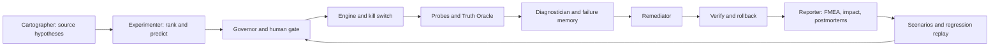

# ChaosPilot

ChaosPilot tests resilience in an isolated Docker Example Voting App.
Cartographer reads source and proposes testable weaknesses; Experimenter selects faults.
Deterministic safety checks govern injection, recovery and FMEA scoring.
Diagnostician explains observed failures; Remediator proposes fixes; verification compares risk.
Reporter turns measured outcomes into impact, postmortems and replayable regression scenarios.

## Four proofs

| Proof | Mechanism | Evidence status in this checkout |
|---|---|---|
| Truth Oracle | Unique canary votes compared with stored votes | Team interface/wiring present; real golden-run evidence pending |
| Blind mystery diagnosis | Hidden injection, evidence-only guess, reveal and accuracy history | Harness present; no local measured trial history supplied |
| Fix with proof and rollback | Deterministic RPN comparison and per-fix verdict | Mock-tested; cited teammate run artifacts pending |
| Never again | Confirmed-failure export, engine replay, invariant checks, CI workflow | Offline tests pass; live replay and GitHub Actions not yet verified |

## Quick start

Python 3.10+ (3.11 recommended), Git, Docker with Compose, and an isolated sandbox are required.
In a fresh directory:

```powershell
git clone https://github.com/arthambansal/bosch_hack.git
cd bosch_hack
git checkout tejas
python -m venv .venv
.\.venv\Scripts\Activate.ps1
python -m pip install -r requirements.txt
git clone https://github.com/dockersamples/example-voting-app sandbox/app-src
python tests/test_contract_v5.py
python tests/test_graph_mock.py
python tests/test_regression.py
python tests/test_report_v2.py
python docs/test_tejas.py
```

For the existing checkout, stay on `tejas`; do not clone again. On POSIX activate
`.venv/bin/activate`. The source checkout remains gitignored. Keep API credentials
in environment variables only, following `core/llm.py`; no API key is required for
replay or mock tests. `--offline` uses cached AI responses or deterministic fallbacks.

For an isolated live sandbox:

```powershell
python chaospilot.py up
python chaospilot.py map
python chaospilot.py baseline --seconds 15
python chaospilot.py dashboard
```

Open a second activated terminal for an approved run:

```powershell
python chaospilot.py autopilot --approve --no-heal --max 3
```

Reports are written under `runs/auto_*/report.md` and `report.html`. Baseline comes
before faults. Obtain human approval for data-store disruption; the main pipeline
Governor currently gates combined faults, while the replay implementation also gates
data-store disruption. Create `STOP` or use the dashboard STOP to halt injection.

## Never-again replay

Reporter exports only confirmed failures with measured fault windows and at least
two investigation evidence quotes. Inspect `scenarios/*.json` before committing.
Missing measurements fail checks rather than silently passing. No failed scenario
is fabricated from the successful Day 1 E1 run.

To explicitly restore the base configuration before a weakness demonstration (on
your isolated sandbox, with no other active run):

```powershell
docker compose -f sandbox/docker-compose.yml up -d --force-recreate
python chaospilot.py map
python chaospilot.py baseline --seconds 15
python chaospilot.py replay --scenario scenarios/<actual-exported-id>.json
```

A reproduced weakness returns exit code 1. After an approved fix, replay against the
fixed configuration and require PASS. `python chaospilot.py replay` runs all saved
scenarios with the current CLI; the requested positional path / `--all` parser change
is documented for Artham in `docs/day2/TEJAS_HANDOFF.md`. No AI is used during replay.

The workflow `.github/workflows/resilience.yml` runs on push/pull request in a fresh
base sandbox. Unattended CI accepts single non-stateful kill/pause scenarios only;
combined or data-store disruptions retain local human approval. Netem faults have
not been validated in CI. Empty or unsupported scenario sets fail explicitly.
**The workflow has not been observed running on GitHub; live chaos CI is not claimed.**

## Architecture



Details and ownership boundaries: `docs/ARCHITECTURE.md` and
`docs/day2/DAY2_CONTRACT.md`.

## Safety and scoring

Targets must be configured sandbox services and carry the matching Compose project
label. Limits: at most two faults, at most one data store down; runtime guard checks
errors, p95 latency, blast radius, STOP and maximum duration. Restoration and traffic
shutdown run on replay failure too. Source tools are confined/read-only; hypotheses
remain open until experimental evidence supports them. Code patches are suggestions.
FMEA S/O/D and RPN come from code, never an LLM; the resilience score is deterministic
and applies to the experiments observed, not a universal reliability guarantee.

## Results and honest limits

| Available real evidence | Measurement |
|---|---|
| Day 1 healthy baseline, 15 s | 31 accepted / 31 delivered |
| Day 1 approved Redis kill | 24 accepted / 24 delivered; no stuck worker |
| Guard fault window / HTTP recovery after restoration | 4.5 s / 1.5 s |
| Single-test RPN / resilience score | 98 / 95 out of 100 |

These preserved records are in `docs/evidence/e1/`. They describe that trial only.
Day 2 assignment claims (worker exit 1, combined loss 17/40, E2 RPN 270 to 30) await
raw teammate run artifacts and are not included as locally verified results. See
`docs/FINDINGS.md`. Outage duration uses an explicitly labelled fault-window proxy
when intervals are unavailable; unknown measurements remain null. Trial-history
accuracy, regression CI, real fix verification, golden video and official submission
remain pending evidence. Mock runs are simulations and must never be cited as live results.

## Team

Artham: orchestration, Governor, mystery and verification. Pratham: probes, Truth
Oracle and remediation. Dipen: diagnosis and failure memory. Samridhi: Control Room
and notifications. Tejas: Cartographer, Reporter, regression/CI and deliverables.

Before every push run the contract, graph and Tejas tests above. Stage exact owned
files; do not stage `dependencies.local.json`, secrets, generated runs or the source
clone. Team form and recording status: `docs/TEAM_FORM.md`, `docs/VIDEO_SCRIPT.md`.
