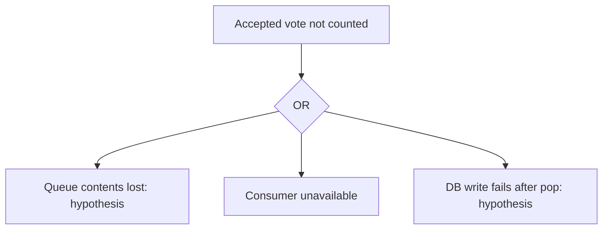

# ChaosPilot findings report

**Resilience score: 61/100 (grade D)** -> after fixes: 63/100 (D)

Experiments run: 3. Stop reason: experiment budget used.

## Executive summary

3 experiment records; resilience score 61/100 (grade D).

## Recon (before any attack)
Single points of failure: redis, db

- Hypothesis: If redis DNS resolution fails in GetIp, OpenRedisConnection does not retry it; Main returns exit code 1. Without a restart policy the worker stays down and accepted votes stop being processed. [FROM SOURCE; HYPOTHESIS] worker/Program.cs:15:         public static int Main(string[] args); worker/Program.cs:62:             catch (Exception ex); worker/Program.cs:65:                 return 1;; worker/Program.cs:105:         private static ConnectionMultiplexer OpenRedisConnection(string hostname); worker/Program.cs:108:             var ipAddress = GetIp(hostname);; worker/Program.cs:118:                 catch (RedisConnectionException); worker/Program.cs:126:         private static string GetIp(string hostname); worker/Program.cs:127:             => Dns.GetHostEntryAsync(hostname)
- Hypothesis: if redis crashes, its dependents recover on their own and no data is lost
- Hypothesis: if db crashes, its dependents recover on their own and no data is lost

## Weaknesses ranked by risk (FMEA)

| Rank | ID | Failure mode | Effect | S | O | D | RPN | Priority |
|---|---|---|---|---|---|---|---|---|
| 1 | E3 | kill db | cascade: result, worker crashed and never restarted on their own | 9 | 7 | 10 | 630 | High |
| 2 | E2 | pause redis | cascade: worker crashed and never restarted on their own | 9 | 3 | 10 | 270 | High |
| 3 | E1 | partition redis | major outage (75% of requests failed) | 7 | 5 | 2 | 70 | Medium |

## Root causes (InvestigatorAgent)
### E1: KILL SWITCH: vote_write error rate 75% >= 50%
Confidence: low (by rules)
- evidence: vote_write: error_rate=75.0%
- evidence: Experiment stopped: KILL SWITCH: vote_write error rate 75% >= 50%
- evidence: {'probes': True, 'recovers': False, 'data_loss': True}
- suggested fix: investigate manually

### E2: worker crashed during the fault and has no restart policy, so it stayed down
Confidence: medium (by rules)
- evidence: worker was stopped at inspection; exit_code=1
- evidence: vote_write: error_rate=66.7%
- evidence: vote_write: p95=2505.7ms exceeds twice baseline=12.5ms
- evidence: Observer: worker exited at t=1791631916; exit_code=1
- evidence: Experiment stopped: KILL SWITCH: vote_write error rate 100% >= 50%
- evidence: worker exit code 1
- evidence:    --- End of inner exception stack trace ---
- evidence:    at Worker.Program.Main(String[] args) in /source/Program.cs:line 67
- suggested fix: restart: unless-stopped, plus reconnect-with-retry in the client

### E3: result, worker crashed during the fault and has no restart policy, so it stayed down
Confidence: medium (by rules)
- evidence: result was stopped at inspection; exit_code=1
- evidence: worker was stopped at inspection; exit_code=1
- evidence: result_page: error_rate=75.0%
- evidence: Recovery not observed within measurement window
- evidence: Observer: db exited at t=1791631943; exit_code=137
- evidence: Observer: result exited at t=1791631943; exit_code=1
- evidence: Observer: worker exited at t=1791631943; exit_code=1
- evidence: Experiment stopped: KILL SWITCH: result_page error rate 75% >= 50%
- evidence: result exit code 1
- evidence: worker exit code 1
- evidence: 
- evidence: Node.js v18.20.4
- evidence:     Line: 207
- evidence:     Routine: secure_read
- suggested fix: restart: unless-stopped, plus reconnect-with-retry in the client

## Fixes applied in the sandbox (RemediatorAgent)
- **restart-policy** for E3, E2: Crashed containers stayed down until a human restarted them. Add `restart: unless-stopped`.

## Before vs after (Verifier)

| ID | Failure mode | RPN before | RPN after | Reduction |
|---|---|---|---|---|
| E3 | kill db | 630 | 700 | -11% |
| E2 | pause redis | 270 | 30 | 89% |

## Detection and recovery

MTTD/MTTR require Observer measurements. Legacy HTTP probe timings are shown separately; they do not prove end-to-end vote recovery.

| Experiment | MTTD | MTTR | First HTTP error | HTTP recovery after restoration |
|---|---|---|---|---|
| E1 | 0.6 s | 0.4 s | 0.5 s | 0.4 s |
| E2 | 5.6 s | 0.4 s | 0.5 s | 0.4 s |
| E3 | 0.7 s | unknown / not measured | 0.6 s | unknown / not measured |
Mean mttd_s: 2.3 s; measured samples 3/3. Unknown/non-recovery observations are not zeros.
Mean mttr_s: 0.4 s; measured samples 2/3. Unknown/non-recovery observations are not zeros.

### Per failure mode

| Fault / target | Mean MTTD | Samples | Mean MTTR | Samples |
|---|---|---|---|---|
| kill:db | 0.7 s | 1/1 | unknown / not measured | 0/1 |
| partition:redis | 0.6 s | 1/1 | 0.4 s | 1/1 |
| pause:redis | 5.6 s | 1/1 | 0.4 s | 1/1 |

## Fault tree: accepted vote not counted

Recorded aggregate loss: none recorded / insufficient evidence. This does not localise the loss mechanism.
Worker reported stuck: E2, E3. Queue loss and DB-write branches need intervention evidence; no probabilities are assigned.

## Heatmap

The service × fault heatmap is in report.html. Combined experiments are labelled; untested cells remain unknown.
