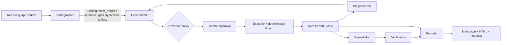

# ChaosPilot — architecture one-pager

**Scope:** Docker Example Voting App in compose project `chaos`, network `chaosnet`. No production or shared infrastructure. Implementation snapshot: base `9b6fdd82dc4f464a997685d36347a523b05dc10e`, Tejas branch.

**Application flow:** user → Flask vote → Redis queue → .NET worker → PostgreSQL; Node result reads PostgreSQL. Dependency map merges compose declarations, sampled TCP connections and configured manual edges.

**Tejas boundary:** Cartographer uses bounded source tools and emits source hypotheses with file, line and function evidence. Source evidence is not runtime proof. Current W1 fallback identifies DNS resolution outside the Redis retry loop and `Main` exit 1. Typed Hypothesis records retain the Section 8.2 fields in a separate artifact, preserving the existing state contract. Reporter computes summary facts from supplied results, preserves missing timings as unknown, distinguishes HTTP recovery from end-to-end delivery, and marks fault-tree branches requiring evidence. AI may select supplied summary facts; invalid responses fall back to deterministic text.

**Safety and ownership:** no source writes or command execution by source tools; resolved paths must stay within the source root. Faults remain in the existing catalog and sandbox checks. Guard, STOP and reverse restoration remain in the existing engine. Human approval is mandatory for data-store kills; the documented single-E1 harness records externally obtained approval because the current Windows terminal gate fails. Schemas, state, knowledge tables, planner, Governor and Dipen's files are unchanged.

**Validated:** seven simulated graph checks; Tejas regression checks; one real Redis-kill experiment after human approval. **Not validated:** live LLM reasoning, canary-derived timing, verified fixes, mystery diagnosis, two-laptop runs, full Section 8 feedback loops or Section 9 Knowledge Store persistence. These belong to the wider team integration; this page does not claim them complete.
