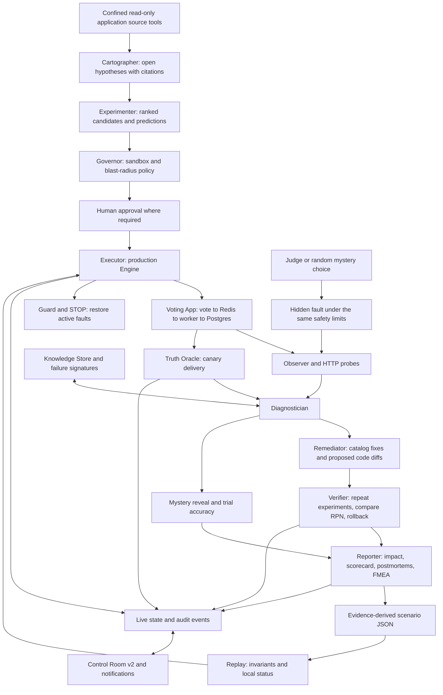

# ChaosPilot architecture — Day 2

Four reasoning agents investigate and propose: Cartographer, Experimenter,
Diagnostician and Remediator. Deterministic Governor, Executor, Evaluator, Verifier
and Reporter control safety and compute numbers. Runtime objects stay out of the
JSON graph state; interfaces remain those in CONTRACT.md and DAY2_CONTRACT.md.

## Tejas boundary

Source tools expose bounded list/read/grep without writes or command execution.
Cartographer verifies source citations and keeps hypotheses open; fallback W1 cites
GetIp, OpenRedisConnection and Main. It does not turn a valid quote into runtime proof.

Reporter retains deterministic FMEA and score, timing coverage, executive summary,
fault tree and heatmap. Day 2 adds request-count-weighted impact, an explicit outage
proxy when duration cannot be measured, prediction/mystery/fix counters, postmortems
and before/after fix verdicts including rollback. HTML escapes evidence text. It
exports confirmed failures with investigation quotes and publishes regression rows.

Regression validates scenarios before constructing Engine, enforces documented
Governor limits using the supplied cfg and invokes the existing human gate for
combined/data-store disruption. Engine retains actual sandbox label checks, Guard
and restoration. Replay always checks measured recovery and per-scenario invariants;
missing measurements fail. It stores status without changing a scenario's evidence.
CI runs on an isolated base sandbox and currently supports unattended single
non-stateful kill/pause scenarios only.

## Ownership and validation

Artham owns runtime/state/contracts/CLI/engine; Pratham owns Truth Oracle/probes/fixes;
Dipen owns diagnosis/memory; Samridhi owns dashboard/notifications. Tejas touches only
his assigned report/regression/source/documentation files and new feature tests.
The CLI syntax handoff is in docs/day2/TEJAS_HANDOFF.md; no shared contract was changed.

The contract, graph, regression and report checks use mocks. Live evidence preserved
locally is the earlier single approved Redis-kill trial, not a Day 2 golden run.
Truth Oracle, mystery accuracy, verified live fixes and CI execution require their
respective real artifacts. The diagram describes integrated responsibilities, not
proof that every subsystem has been live-validated on this laptop.
