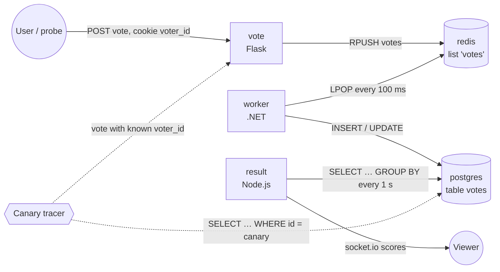
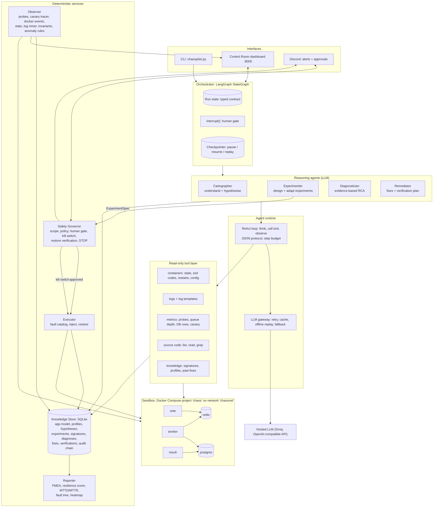
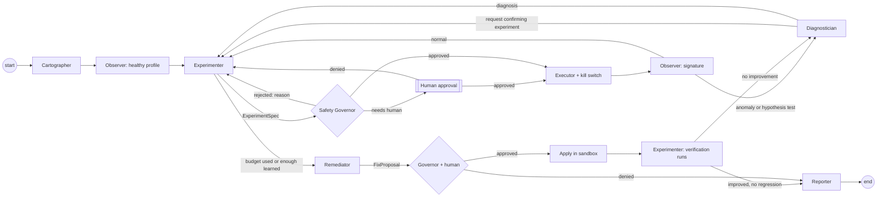
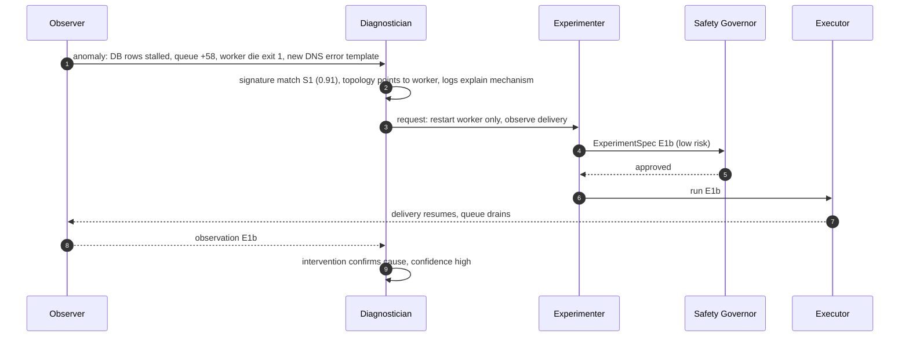

# ChaosPilot — Project Blueprint (final design)

**Team:** Artham, Pratham, Samridhi, Dipen, Tejas · **Event:** Bosch Hackathon, AI-Driven Chaos Engineering for Cloud-Native Resilience
**Target application:** Docker Example Voting App — https://github.com/dockersamples/example-voting-app (Apache-2.0)
**Document status:** canonical design, 10 Oct. Supersedes TEAM_PLAN.md and earlier notes. Read Sections 0–3 before anything else.

---

## 0. How to use this document

- **Teammates:** upload this whole file to your LLM, then add: *"I am <name>. My role is in Section 20. Help me build my part exactly as specified here. Do not change any data format in Sections 8 and 9. Ask me before assuming anything."*
- **Tags used throughout:**
  - `[REQUIRED]` — demanded by the Bosch problem statement.
  - `[OURS]` — our addition beyond the brief.
  - `[MEASURED]` — we observed it on our sandbox.
  - `[FROM SOURCE]` — read from the Voting App source code; not yet tested.
  - `[HYPOTHESIS]` — expected but unproven.
  - `[VERIFY]` — check before relying on it.
- **Rule for the whole team:** never present a hypothesis as a result. Judges at Bosch will ask "how do you know?" The answer must always be a measurement or a quoted log line.

---

## 1. Executive summary

ChaosPilot is a **governed multi-agent system** that learns how a containerised application behaves, breaks it in controlled ways to learn how it fails, diagnoses failures from evidence, fixes them in the sandbox and **proves** the fix with before/after measurements. Results are reported in the risk language automotive engineers already use (FMEA, fault trees, MTTD/MTTR).

What it does, end to end, on the Voting App:

1. **Understand.** The Cartographer agent reads the compose file, the live network connections and the application **source code**. It produces a dependency map and a list of testable hypotheses, for example "the worker exits if the Redis hostname cannot be resolved" `[FROM SOURCE]`.
2. **Learn healthy behaviour.** A deterministic Observer measures normal latency, error rate, throughput, queue depth and log patterns. It also measures **end-to-end vote delivery**, using traceable canary votes.
3. **Learn failure behaviour.** The Experimenter agent designs experiments to test the hypotheses, riskiest and most informative first. Each experiment passes a Safety Governor (policy + human approval) and runs under a deterministic kill switch. Every outcome is stored as a structured **failure signature**.
4. **Detect and diagnose.** The Diagnostician agent combines three evidence sources: statistical deviation from the healthy profile, similarity to known failure signatures, and dependency-graph localisation. It confirms causes **by intervention**, asking the Experimenter to run a confirming experiment. It works on faults it has never seen, which we prove with a blind "mystery fault" test.
5. **Fix and verify.** The Remediator agent proposes configuration fixes (applied in the sandbox after approval) and code patches (proposed as diffs, never auto-applied). The Experimenter re-runs the original attack plus a regression check, and the fix is kept only if measurements improve.
6. **Report.** An FMEA-ranked findings report gives each failure mode a Risk Priority Number (RPN), and the report adds a resilience score, MTTD/MTTR and a fault tree. Discord alerts go out, and a hash-chained audit trail records every AI decision.

**One-line pitch:** *"An AI reliability team that reads the code, predicts where the system will break, proves it safely with a human in control, finds the root cause, fixes it, and proves the fix — in FMEA terms."*

---

## 2. The problem statement, and exactly how we meet it

| Brief requirement | Our component | Tag |
|---|---|---|
| Select a free, open-source, cloud-native app from public GitHub; run it in our own sandbox | Voting App via Docker Compose, project `chaos`, isolated network `chaosnet` | `[REQUIRED]` |
| Map services, dependencies and data flows (automatic or semi-automatic) | Cartographer agent + Observer: compose labels, live TCP connections, source code; manual corrections allowed | `[REQUIRED]` |
| Plan experiments intelligently, riskiest/most informative first | Experimenter agent: hypothesis-driven, adaptive, with a deterministic risk ranking as a cross-check | `[REQUIRED]` |
| Inject controlled failures with safety limits (error rate, latency, blast radius) | Executor + Safety Governor + Guard kill switch | `[REQUIRED]` |
| Observe errors, slowdowns, recovery time | Observer: probes, canary tracer, container events, logs, MTTD/MTTR | `[REQUIRED]` |
| Analyse: identify weaknesses, recommend fixes, ranked resilience score | Diagnostician + Remediator + Reporter (FMEA, resilience score) | `[REQUIRED]` |
| Milestone D1: app running, map, baseline, ≥1 failure, safety control tested, demo | Section 20 Day-1 gate | `[REQUIRED]` |
| Milestone D2: AI planner with reasons, ≥3 failure types, AI findings with fixes and score | Section 20 Day-2 | `[REQUIRED]` |
| Stretch: re-run after fix | Remediator → verification protocol | `[REQUIRED]` (stretch) |
| Stretch: live dashboard | Control Room UI | `[REQUIRED]` (stretch) |
| Stretch: combined failures | Combined experiments, e.g. worker down + Redis crash | `[REQUIRED]` (stretch) |
| Deliverables: code+README, ≤3-min video, architecture page, findings report, team form | Section 20 deliverables | `[REQUIRED]` |
| Out of scope: no real systems, nothing outside our sandbox, no shared infra | Safety Governor scope checks (Section 13) | `[REQUIRED]` |
| Code-aware hypotheses, canary tracing, active (interventional) diagnosis, mystery-fault evaluation, verified fixes with regression check, FMEA/FTA, audit trail, ChatOps | Our differentiators | `[OURS]` |

---

## 3. The target application, studied properly

### 3.1 Services

| Service | Tech | Role | Key behaviour (from source) |
|---|---|---|---|
| `vote` | Python/Flask | Entry point, port 8080 on host | Reads cookie `voter_id` (generates one if absent). On POST, `rpush('votes', {"voter_id","vote"})` to Redis host `redis`, `socket_timeout=5`. **No error handling**, so a Redis failure gives HTTP 500. `[FROM SOURCE]` |
| `redis` | Redis 7.2 | Queue (list `votes`) | In-memory. No persistence configured in our compose (no AOF), so data in the queue is lost on crash. `[FROM SOURCE]` |
| `worker` | .NET | Consumer | Resolves `redis` to an IP **once** with `Dns.GetHostEntryAsync`; connection retries only catch `RedisConnectionException`. Loop: non-blocking `LPOP votes` every 100 ms, then `INSERT`, and on any DB error an `UPDATE` (re-vote). On DB reconnect, **the vote popped in that iteration is not written**. Any unhandled exception: `catch (Exception)` → **exit code 1**. `[FROM SOURCE]` |
| `db` | PostgreSQL 15 | Store, table `votes(id UNIQUE, vote)` | `id` = the voter's `voter_id`, so one row per voter (a re-vote updates). `[FROM SOURCE]` |
| `result` | Node.js | Read side, port 8081 on host | Retries DB connection at startup (up to 1000×, 1 s). Then polls `SELECT vote, COUNT(id) … GROUP BY vote` every ~1 s and pushes via socket.io. **Holds one DB client with no runtime reconnect.** `[FROM SOURCE]` |

### 3.2 Data flow



### 3.3 Weak points the source code predicts (the Cartographer must find these by itself)

| # | Predicted weakness | Evidence | Status |
|---|---|---|---|
| W1 | Killing Redis makes the **worker exit permanently**: its DNS lookup of `redis` throws, which is not a `RedisConnectionException`, so it is not retried and the process exits 1. Nothing restarts it, so votes silently stop being processed. | `GetIp`, `OpenRedisConnection`, `Main` catch | **`[MEASURED]`** 10 Oct: worker `Exited (1)`, log "Name or service not known" with stack `GetIp → OpenRedisConnection → Main`; queue held 58 votes while DB stayed at 80; vote page healthy again within 0.5 s |
| W2 | **At-most-once delivery.** A vote is removed from Redis (`LPOP`) before it is written. If the worker dies or reconnects to the DB at that moment, that vote is lost. | `LPOP` before insert; DB-reconnect branch skips the popped vote | `[FROM SOURCE]` `[HYPOTHESIS]`: a DB outage loses exactly the in-flight vote(s) |
| W3 | Redis crash loses every vote waiting in the queue (no persistence). | Compose has no AOF/RDB configuration for the queue | `[HYPOTHESIS]`; the combined experiment "worker down, then Redis crash" should show large loss |
| W4 | After a DB restart the **result page goes stale indefinitely**: one DB client, no reconnect, errors logged every second. | `result/server.js` single client | `[FROM SOURCE]` `[HYPOTHESIS]` |
| W5 | Redis slowdown or freeze makes vote requests hang up to 5 s and then fail with 500 (no fallback). | `socket_timeout=5`, no try/except | `[HYPOTHESIS]` |
| W6 | If Redis gets a new IP after restart, the worker keeps reconnecting to the old one, because it resolves the IP only once. | IP resolved once, by design (code comment) | `[HYPOTHESIS]` `[VERIFY]` whether Docker reassigns the same IP |
| W7 | `vote` and `result` are single instances: a crash means a full outage of that path. | Compose: one replica each | `[HYPOTHESIS]` (trivially expected; low information value) |

These seven items are the backbone of the demo. They are real, specific and testable, which is what separates us from a generic "kill a container" demo.

---

## 4. Critical assessment of our original four-agent proposal

**What was right.** The lifecycle Understand → Learn healthy → Learn failure → Detect → Diagnose → Fix → Verify is correct, and it maps cleanly onto the brief's five steps. A shared knowledge base and before/after verification are exactly what makes this more than a script.

**What was wrong or missing:**

1. **"Healthy learning" is mostly not agent work.** Computing p95 latency or an error rate needs no LLM. Calling a statistics job an agent is the "predefined steps under agent names" trap we wanted to avoid. **Fix:** split it. A deterministic **Observer** does the measuring; a reasoning **Cartographer** interprets architecture and code and produces hypotheses.
2. **Experiment planning was hidden inside "failure learning".** The brief explicitly scores "AI ranks and selects experiments with a short reason". **Fix:** make planning the Experimenter's core decision: hypothesis-driven, adaptive, budgeted.
3. **Safety was not a component.** The brief requires automatic stop on thresholds. Safety must be **deterministic and outside every agent's control**. **Fix:** a Safety Governor with policy, human gate, kill switch and restoration checks.
4. **"Detect failures in production, including code changes" drifts into AIOps monitoring**, which the brief does not ask for. **Fix:** keep detection, but ground it in our sandbox. Detect the effects of injected faults, and prove generality with a **blind mystery-fault test** (the agent is not told what was broken). Code-change awareness becomes a Day-2+ extension, not a pillar.
5. **A sequential pipeline is not collaboration.** Four agents handing a baton is a workflow. **Fix:** add explicit feedback loops where agents ask each other for work (Section 8.4). The key loop is that the Diagnostician can request a confirming experiment from the Experimenter, and a failed fix sends the case back to the Diagnostician.
6. **"Learning" was undefined.** **Fix:** define it concretely as statistical profiles, a failure-signature case base with similarity retrieval, a dependency/causal graph updated by experiments, hypothesis status tracking and fix-outcome memory. No model training (Section 9).
7. **No evaluation of the AI itself.** Engineers will ask how well the agents work. **Fix:** measure hypothesis precision, prediction accuracy, mystery-fault diagnosis accuracy and fix success rate (Section 22).

**Verdict.** Keep four reasoning agents. Each owns a distinct decision under uncertainty, with distinct tools, memory and success metric, which is what justifies an agent. Re-scope them, and surround them with deterministic services for measurement, execution and safety.

---

## 5. Recommended architecture: a governed multi-agent system

### 5.1 Shape

- **Four reasoning agents (LLM):** Cartographer, Experimenter, Diagnostician, Remediator.
- **Deterministic services (no AI, trustworthy by construction):** Observer, Executor, Safety Governor, Knowledge Store, Reporter.
- **Orchestrator:** a LangGraph state machine. The agents decide *what* to do inside their step; the graph decides *what is allowed to happen next*, enforces budgets and pauses for humans.
- **Interfaces:** CLI, the Control Room dashboard, Discord ChatOps.

**Coordination style:** collaborative work on a shared blackboard (state + Knowledge Store), supervised by a deterministic state machine, with peer requests between agents. We rejected a free-form "agents chat with each other" design (AutoGen-style) and an LLM supervisor that picks the next agent. Both are unpredictable, and unpredictability is unacceptable in a tool that breaks things.

### 5.2 System diagram



### 5.3 Why each piece is (or is not) an agent

| Component | Agent? | Reason |
|---|---|---|
| Cartographer | Yes | Interprets ambiguous evidence (code, config, traffic) and forms hypotheses. That is judgment. |
| Experimenter | Yes | Chooses the next experiment under uncertainty, trading information against risk. Adapts to results. |
| Diagnostician | Yes | Weighs conflicting evidence, separates symptoms from causes, decides when to seek more evidence. |
| Remediator | Yes | Maps a root cause to a concrete change and designs how to prove it worked. |
| Observer | No | Measurements must be reproducible and trustworthy. |
| Executor | No | Fault injection must be exact and reversible. |
| Safety Governor | No | Safety must never depend on a model's output. |
| Reporter | Mostly no | Numbers are deterministic. An LLM writes only the narrative summary, constrained to numbers in the data. |

---

## 6. Agent-by-agent design

Every agent has an objective, the decisions it owns, its inputs, its tools (all read-only), a structured output, its memory, a decision method, a fallback for when the LLM is unavailable, and a success metric.

### 6.1 Cartographer (Understand)

- **Objective:** build an accurate model of the application and a ranked list of testable hypotheses about how it can fail.
- **Owns the decisions:** what each service is (role: entrypoint, queue, consumer, store, read-side); which dependencies are critical; which code paths can fail badly; which hypotheses are worth testing first.
- **Inputs:** compose file; Observer's live dependency edges (TCP connections) and healthy profile; the cloned source tree in `sandbox/app-src`; container config (env var *names* only).
- **Tools:** `list_containers`, `service_config`, `dependencies`, `list_files`, `read_file`, `grep` (restricted to `sandbox/app-src`), `knowledge.lookup_role_patterns`.
- **Output:** `ApplicationModel` + list of `Hypothesis` (schema in Section 8.2).
- **Decision method:** a ReAct loop. For every dependency edge, find the client code for that edge, check timeouts, retries, error handling and delivery semantics, then turn each risky finding into a falsifiable hypothesis with a code citation (file + function).
- **Example `[MEASURED]`-backed output:** *H1: "If redis becomes unresolvable, worker exits with code 1 and stays down; votes accumulate unprocessed. Evidence: worker/Program.cs GetIp uses Dns.GetHostEntryAsync; OpenRedisConnection catches only RedisConnectionException; Main catch returns 1." Priority: high.*
- **Fallback:** rules from the dependency graph (stateful service with dependents gives the hypothesis "if X fails, dependents recover and no data is lost").
- **Success metric:** hypothesis precision, meaning the share of hypotheses later confirmed by experiment.

### 6.2 Experimenter (Plan and learn failure behaviour)

- **Objective:** learn as much as possible about failure behaviour with the fewest, safest experiments.
- **Owns the decisions:** which experiment next, at what intensity, alone or combined, and when learning is sufficient. It also handles **confirmation requests** from the Diagnostician and **verification plans** from the Remediator.
- **Inputs:** open hypotheses; the healthy profile; the case base of past signatures; results so far; Governor feedback; an optional user what-if goal.
- **Tools:** `candidate_experiments` (generated by code from the dependency map and fault catalog), `knowledge.similar_experiments`, `predict_blast_radius` (graph-based, deterministic).
- **Output:** `ExperimentSpec` with a **falsifiable prediction** (which probes fail, data loss yes/no, recovers yes/no, expected MTTR range).
- **Decision method (hybrid):**
  1. Code generates the candidate list and a deterministic priority, `risk × uncertainty ÷ cost`. Risk comes from the graph and statefulness; uncertainty is high if no similar signature exists; cost is the expected blast radius.
  2. The LLM chooses among candidates, linking each to a hypothesis or goal, and states its prediction.
  3. Code validates the choice. Only candidate IDs are accepted.
  4. **Breaking-point search** `[OURS]`: for latency or traffic, the Experimenter bisects intensity (for example 100 → 800 ms) to find the threshold where the SLO breaks. That produces a resilience envelope, not just pass/fail.
- **Fallback:** the deterministic priority order.
- **Success metrics:** prediction accuracy; new weaknesses found per experiment.

### 6.3 Diagnostician (Detect and diagnose)

- **Objective:** explain *why* the system misbehaved, with evidence and calibrated uncertainty, including for faults it has never seen.
- **Owns the decisions:** is this anomalous; which component is the root cause and which are symptoms; how confident; whether to request a confirming experiment.
- **Inputs:** Observer anomaly report (deviations from the healthy profile, invariant violations, new log templates, container events with timestamps); dependency graph; case base.
- **Tools:** `container_logs`, `log_templates_new_since`, `list_containers`, `queue_depth`, `db_row_count`, `canary_status`, `experiment_timeline`, `compare_to_baseline`, `similar_signatures`, `read_file`/`grep` (to explain mechanism from code), and `request_experiment` (a peer request; the Experimenter and Governor decide).
- **Output:** `Diagnosis` (Section 8.2) with ranked differential diagnoses, evidence for and against, confidence, and "what would change my mind".
- **Method:** see Section 11.
- **Fallback:** rule-based localisation (deepest anomalous dependency with an exit event or a new error template).
- **Success metric:** top-1 and top-3 accuracy on blind mystery faults; calibration (high-confidence diagnoses must be right).

### 6.4 Remediator (Fix and verify)

- **Objective:** turn a confirmed diagnosis into a concrete change, and prove it improves resilience without making anything else worse.
- **Owns the decisions:** which fix, at which layer (runtime action, configuration, code), what to verify, and whether to accept or roll back.
- **Inputs:** `Diagnosis`; the fix catalog; past fix outcomes; source code.
- **Tools:** `fix_catalog`, `knowledge.fix_outcomes`, `read_file`/`grep`, `draft_compose_override` (validated against a key whitelist), `draft_code_patch` (returns a diff, never applied).
- **Output:** `FixProposal` (Section 8.2) and a `VerificationPlan` handed to the Experimenter.
- **Fallback:** catalog lookup by root-cause category.
- **Success metric:** verified-fix rate; RPN reduction; zero regressions.

---

## 7. Observation layer: what we collect from each service

### 7.1 Signals per service

| Service | Signals | How collected | Healthy profile | Anomaly rule |
|---|---|---|---|---|
| vote | HTTP status and latency of POST `/`, every 0.5 s | `requests` probe | error rate, p50/p95/p99, throughput | error rate > 3σ above baseline or > 5%; p95 > 2× baseline |
| vote | log lines ("Received vote for …", tracebacks) | `docker logs --since`, template mining | template frequency set | new template, or error template |
| redis | queue depth `LLEN votes`, `INFO` (clients, memory, persistence) | `docker exec redis-cli` | queue depth ≈ 0 | queue growing for > 5 s |
| worker | container state, exit code, restart count, logs | `docker inspect`, `docker events`, logs | running, 0 restarts | `die` event; exit code ≠ 0; new error template |
| db | row count, canary row present | `docker exec psql` | rows grow with votes | rows stop growing while votes accepted |
| result | HTTP GET latency/status, logs ("Error performing query") | probe + logs | 200, no error template | error template repeating |
| all | CPU %, memory | `docker stats --no-stream` | mean, std | > 3σ |
| pipeline | **end-to-end delivery**: canary votes with a known `voter_id` cookie, checked in Postgres | Observer canary tracer, every 5 s | delivery ratio 100%, lag p95 | ratio < 100% means **silent loss**; lag > 3× p95 means **delayed processing** |

### 7.2 The canary tracer `[OURS]` (why it matters)

The vote service trusts the `voter_id` cookie, and the database row id *is* that `voter_id` `[FROM SOURCE]`. So the Observer can send a vote with cookie `voter_id=canary-<n>` and then query `SELECT 1 FROM votes WHERE id='canary-<n>'`. That gives an exact, per-vote, end-to-end check:

- **delivery lag:** time from accepted POST until the row exists (catches delayed processing);
- **silent loss:** accepted, but the row never appears (catches W1, W2 and W3);
- **zero false alarms from re-votes**, because each canary has a unique id.

Most chaos tools only check "is the page up?". This catches the failure that matters most and is hardest to see: the user was told "accepted" and the data vanished.

### 7.3 How the four classic problems are detected

| Problem | Detected by |
|---|---|
| Silent vote loss | canary never delivered; accepted − delivered > 0 in the delivery audit; queue emptied by a crash (LLEN drop without DB growth) |
| Delayed processing | canary lag above baseline p95 × 3; queue depth slope > 0 |
| Service unavailability | probe errors/timeouts; `die` events; container not running |
| Cascading failure | a service **not targeted** shows symptoms; time-ordered symptom onset follows dependency edges; a container exits after the fault ends (for example, the worker after a Redis kill) |

### 7.4 Integration points

- **Containers:** `docker inspect` (state, exit code, restart policy, mounts), the `docker events` stream (die/start/restart with timestamps, used for MTTD), and `docker stats`.
- **Logs:** `docker logs --since <t>`, then template mining. Numbers, hex ids and IPs are masked into tokens, so "new kind of message" can be detected without ML.
- **Probes:** HTTP probes on user paths and the canary tracer.
- **Dependencies:** compose `depends_on` labels, live TCP connections from `/proc/net/tcp` in each container, and code references found by the Cartographer.

---

## 8. Communication and orchestration

### 8.1 Three channels

1. **Run state (blackboard):** a typed LangGraph state object passed between steps. It is the contract between teammates.
2. **Knowledge Store:** SQLite. Persists across runs, so the next run starts smarter.
3. **Event stream:** append-only `events.jsonl`, hash-chained for audit. It feeds the dashboard and Discord.

Agents never pass free text to each other. They pass **typed artifacts with evidence pointers**, validated with Pydantic before anyone uses them.

### 8.2 Message schemas (examples use the Voting App)

```json
// Hypothesis  (Cartographer -> Experimenter)
{"id":"H1","statement":"If redis is unresolvable, worker exits (code 1) and stays down; accepted votes are not processed",
 "source":"code","evidence":["worker/Program.cs: GetIp uses Dns.GetHostEntryAsync",
 "OpenRedisConnection retries only RedisConnectionException","Main catch returns 1"],
 "affected":["worker","redis"],"priority":"high","status":"open"}

// ExperimentSpec  (Experimenter -> Safety Governor -> Executor)
{"id":"E1","tests":"H1","steps":[{"type":"kill","target":"redis","delay_s":0}],"duration_s":20,
 "prediction":{"probes_failing":["vote_write"],"data_loss":true,"recovers_without_help":false,"mttr_s":[null,null]},
 "abort_if":{"error_rate":0.5,"p95_ms":2500,"unpredicted_probe_failing":true,"max_s":45},"risk":"medium"}

// Observation summary  (Observer -> everyone)
{"experiment":"E1","mttd_s":0.5,"mttr_s":null,"probe_error_rate":{"vote_write":0.75,"result_page":0.0},
 "delivery":{"accepted":20,"delivered":0,"canary_lag_s":null},"queue_depth":{"start":0,"end":58},
 "events":[{"t":3.1,"service":"redis","event":"die"},{"t":3.9,"service":"worker","event":"die","exit_code":1}],
 "new_log_templates":{"worker":["System.Net.Sockets.SocketException: Name or service not known"]},
 "kill_switch":"fired: vote_write error rate 75% >= 50% x3","stuck_services":["worker"]}

// FailureSignature  (stored in Knowledge Store, used for similarity search)
{"id":"S1","from":"E1","fault":{"type":"kill","target_role":"queue"},
 "features":{"entry_errors":1,"read_errors":0,"queue_growth":1,"db_stall":1,"consumer_exit":1,"new_dns_error":1,"recovers":0},
 "root_cause":"consumer resolves queue hostname once and exits on DNS failure","confirmed":true}

// Diagnosis  (Diagnostician -> Remediator)
{"incident":"I3","root_cause":"worker exited after DNS lookup of 'redis' failed; no restart policy",
 "symptoms":["vote 500s during outage","DB rows stalled","queue depth 58"],
 "differential":[{"cause":"worker crash (DNS)","p":0.85},{"cause":"db unavailable","p":0.1},{"cause":"redis data loss","p":0.05}],
 "evidence_for":["docker event: worker die exit 1 at t=3.9 s","log: Name or service not known","db reachable, rows not growing"],
 "evidence_against":["none for top cause"],"confirmed_by":"E1b: restarting worker alone restored delivery",
 "confidence":"high","would_change_mind":"worker running and still not consuming"}

// FixProposal  (Remediator -> Safety Governor -> human)
{"id":"F1","for":"I3","layer":"config","change":{"service":"worker","restart":"unless-stopped"},
 "why":"turns a permanent outage into a self-healing one","expected":{"mttr_s":"<15","lost_votes":"0 after queue persists"},
 "verification":{"rerun":["E1"],"repeat":3,"must_improve":["mttr_s","delivery_ratio"],"regression_guard":["vote p95 within 10% of baseline"]},
 "code_patch":"worker/Program.cs: catch SocketException in GetIp and retry with backoff (diff attached, NOT applied)",
 "approval":"required"}

// VerificationReport  (Experimenter -> Knowledge Store, Reporter)
{"fix":"F1","runs":3,"before":{"mttr_s":null,"delivery_ratio":0.0,"rpn":630},
 "after":{"mttr_s":[6.1,7.4,5.9],"delivery_ratio":[1.0,1.0,1.0],"rpn":84},
 "regression":{"vote_p95_ms":{"before":41,"after":43}},"decision":"keep"}
```

The numbers in these examples are illustrative, except where Section 3.3 marks them `[MEASURED]`.

### 8.3 Orchestration graph (LangGraph)



**Budgets** (enforced by the graph, not by prompts): maximum experiments per run, maximum LLM calls per agent step (ReAct step budget), maximum fix attempts (2), maximum rejected proposals in a row (3), and a wall-clock limit.

### 8.4 The collaboration loops (this is what makes it a multi-agent system)

1. **Hypothesis loop:** the Cartographer's hypotheses steer the Experimenter. Results update each hypothesis's status (confirmed or refuted, with evidence). Refuted hypotheses change what is tested next.
2. **Active-diagnosis loop:** when the Diagnostician is not confident, it requests a confirming or discriminating experiment (for example "restart only the worker: if delivery resumes, the worker was the cause"). The Experimenter schedules it within budget, and the Governor approves it.
3. **Verification loop:** the Remediator's plan is executed by the Experimenter. If the fix does not help, the case returns to the **Diagnostician**, because a failed fix means the diagnosis was probably wrong.
4. **Safety loop:** the Governor's rejection reasons are fed back to the Experimenter, which must propose something different. Example: "would take down two data stores at once".



---

## 9. Learning and knowledge retention (no model training)

### 9.1 What "learning" means here

| Agent / service | What it learns | Mechanism |
|---|---|---|
| Observer | What normal looks like | Rolling statistics (mean, std, percentiles) per metric; log-template frequency set; delivery-lag distribution |
| Cartographer | Application structure and likely weak points | Structured `ApplicationModel` + hypotheses with status (open / confirmed / refuted) |
| Experimenter | How each fault affects the system; where the breaking points are | Failure signatures (feature vectors + labels); resilience envelopes from bisection; prediction-accuracy history |
| Diagnostician | Symptom → cause patterns | Case-based reasoning: nearest-neighbour similarity over signatures, plus confirmed diagnoses as new cases |
| Remediator | Which fixes work, and their side effects | Fix-outcome records (RPN before/after, regressions) |

**Recommended combination:** statistical profiling + case-based reasoning over structured memory + LLM reasoning over retrieved evidence. This is retrieval-augmented reasoning over **our own structured, measured data**, not a vector database of documents. Optional later: a small anomaly model (for example an isolation forest) on Observer metrics, only if it beats the z-score rules on our recorded runs.

### 9.2 Knowledge Store schema (SQLite)

`app_model`, `services`, `edges(from, to, evidence)`, `profiles(metric, window, mean, std, p50, p95, p99)`, `log_templates(service, template, healthy_count)`, `hypotheses(id, statement, source, evidence, status)`, `experiments(id, spec_json, run_id)`, `observations(experiment_id, summary_json)`, `signatures(id, features_json, labels_json, confirmed)`, `diagnoses(id, json)`, `fixes(id, json)`, `verifications(fix_id, json)`, `audit(seq, ts, actor, action, payload_hash, prev_hash)`.

### 9.3 How the next run improves

Confirmed signatures become priors for diagnosis. Experiments whose outcome is already well known get lower uncertainty, so the Experimenter explores elsewhere. Verified fixes are suggested first for matching root causes. Refuted hypotheses are not re-tested unless the code changes.

---

## 10. Experiment catalog for the Voting App

All rows are hypotheses until run, except E1.

| ID | Fault | Tests | Prediction (what we expect to observe) | Status |
|---|---|---|---|---|
| E1 | Kill `redis` | W1, W3 | vote 500s during outage; worker exits 1 and stays down; queue votes lost; vote page "recovers" while the pipeline stays broken | `[MEASURED]` worker exit + stall; loss count `[VERIFY]` with canary |
| E2 | Kill `worker` | W2, cascade | vote stays healthy; queue grows; canary lag grows; no user-visible error (silent); recovers and drains after restart | `[HYPOTHESIS]` |
| E3 | Stop/kill `db` 10 s | W2, W4 | worker prints "Waiting for db", in-flight vote(s) lost; result logs errors and may stay stale after DB returns | `[HYPOTHESIS]` |
| E4 | Pause `redis` (freeze) | W5 | vote requests hang ~5 s then 500; kill switch trips on latency/timeouts | `[HYPOTHESIS]` |
| E5 | Latency on `redis` 100→800 ms (bisection) | envelope | find the latency where vote p95 crosses the SLO | `[HYPOTHESIS]` |
| E6 | Packet loss on `db` 10–30% | network | worker inserts slow down; canary lag rises; possible reconnects | `[HYPOTHESIS]` |
| E7 | Partition `redis` from network | W1, W6 | same as E1 if DNS entry disappears; else hang/timeouts | `[HYPOTHESIS]` |
| E8 | Traffic spike on `vote` (bisection on concurrency) | capacity | find concurrency where errors or p95 cross SLO | `[HYPOTHESIS]` |
| E9 | CPU throttle `db` (`docker update --cpus 0.1`) | overloaded DB | processing lag increases; no errors; detection only via lag | `[HYPOTHESIS]` |
| E10 | Combined: kill `worker`, then kill `redis` 8 s later | W3 amplified | all votes queued during worker outage are lost | `[HYPOTHESIS]` |
| E11 | Full disk on a bounded tmpfs volume for `db` (Day 2+) | full disk | inserts fail; worker behaviour on write errors | `[HYPOTHESIS]`, only with a size-limited volume |

Coverage of the brief's examples: crash (E1–E3), slow or lossy network (E5–E7), full disk (E11), overloaded database (E9), failed dependency (E1, E3, E7), traffic spike (E8), combined (E10).

---

## 11. Detection and root-cause analysis methodology

**Goal:** never guess. Every diagnosis is built from evidence and, where possible, confirmed by intervention.

**Step 1 — Detect.** The Observer flags anomalies against the healthy profile:
- statistical: z-score > 3 or a percentile breach;
- invariants: delivery ratio, canary lag, queue slope;
- events: `die`, non-zero exit;
- novelty: a log template never seen in the healthy profile.

**Step 2 — Build the symptom set.** List which services show which anomalies, ordered by **onset time**.

**Step 3 — Generate candidate causes, using three independent methods:**
1. **Topology localisation.** Walk the dependency graph from the symptomatic services toward their dependencies. The candidate is the *deepest* component that is anomalous while its own dependencies are healthy.
2. **Signature retrieval.** Find the k nearest confirmed failure signatures, with a similarity score.
3. **Mechanism evidence.** Container events and new error log templates that *explain* a mechanism, such as a DNS exception or "Waiting for db".

**Step 4 — Differential diagnosis.** The LLM receives only the evidence above, never raw guesses. It ranks causes, listing evidence for and against each.

**Step 5 — Confirm by intervention.** If the top two causes are close, request a discriminating experiment. Intervention beats correlation: passive monitoring tools can only correlate, but we can change one thing and watch.

**Step 6 — Confidence:**
- **High:** all three methods agree and an intervention confirmed.
- **Medium:** two methods agree.
- **Low:** otherwise.

Every diagnosis states what evidence would change its mind.

**Symptom vs root cause, as rules of thumb:**
- A symptom appears at or upstream of the user path.
- A root cause is the earliest-onset anomaly in the deepest dependency that has a mechanism explanation.
- An intervention on the root cause removes the symptoms; an intervention on a symptom does not.

**Unseen failures:** if no signature is similar (similarity < 0.6), the case is marked **novel**. The Diagnostician then relies on topology, mechanism evidence and active experiments. After confirmation it is stored as a new signature, so the system has learned.

**Mystery-fault evaluation** `[OURS]`: `chaospilot mystery` injects a random fault (or one chosen by a judge on the dashboard) **without telling the agents**. The Diagnostician must name the fault and target from evidence alone. The result is scored against the hidden truth, and we report top-1/top-3 accuracy over all trials. This is how we prove the agents reason about real behaviour rather than replaying scripted answers. Report only accuracy we actually measured.

**Worked example (E1, real):**
- Symptoms: vote 500s, then recovery; DB rows flat; queue +58.
- Events: redis `die`, then worker `die` with exit 1.
- New template in the worker log: "Name or service not known".
- Topology: worker depends on redis, and redis is back but the worker is down. Worker is the deepest anomalous component with a mechanism.
- Code check: `GetIp` has no retry on `SocketException`.
- Intervention: starting only the worker restores delivery.
- **Root cause: the worker's unhandled DNS failure plus no restart policy. Confidence high.**

---

## 12. Fix, recovery and verification

### 12.1 Fix layers and automation policy

| Layer | Example (Voting App) | Automated? |
|---|---|---|
| Runtime recovery | start the crashed worker | Automatic in the sandbox (part of restore) |
| Configuration | `restart: unless-stopped`; Redis `appendonly yes`; healthchecks with `depends_on: condition: service_healthy`; resource limits | Applied in the sandbox **after Governor check and human approval** |
| Code | worker: catch `SocketException` in `GetIp`, retry with backoff; use `BLMOVE`/`RPOPLPUSH` to a processing list for at-least-once delivery; result: reconnect on query error; vote: handle Redis errors with a clear 503 and retry | **Never automatic.** Generated as a reviewed diff with reasoning |

Configuration changes are restricted to a whitelist of keys (`restart`, `healthcheck`, `command` for redis, `deploy.resources`, `depends_on.condition`). Anything else the Remediator drafts is rejected by code.

### 12.2 Verification protocol

1. Re-run the triggering experiment **three times** (two in the demo profile).
2. Compare MTTR, delivery ratio, lost votes, error rate and RPN before and after. A change counts only if it exceeds the run-to-run noise measured in the baseline.
3. **Regression and trade-off check:** re-measure the healthy profile and one unrelated experiment. Example: `appendfsync always` may add write latency. Measure it and report it as a trade-off rather than hiding it.
4. Decision:
   - **keep** if the target metrics improve and there is no regression above 10%;
   - **roll back** otherwise, and send the case back to the Diagnostician.
5. Store the outcome in the Knowledge Store.

---

## 13. Safety architecture (deterministic, layered)

| Layer | Guarantee |
|---|---|
| 1. Scope | Faults may target only containers carrying compose project label `chaos` on network `chaosnet`; host-level and other-project actions are refused in code |
| 2. Typed catalog | Only catalog fault types; parameters bounded (latency ≤ 1000 ms, loss ≤ 30%, spike ≤ 50 concurrent, duration ≤ 45 s, tmpfs disk only) |
| 3. Policy | ≤ 2 simultaneous faults; ≤ 1 data store (redis/db) down at once; cooldown between experiments; budget per run |
| 4. Human gate | Combined faults, data-store kills during demo, and every configuration fix require approval (terminal, dashboard or Discord); no answer = deny |
| 5. Kill switch | Runtime guard every 0.5 s: error-rate, latency, unpredicted blast radius, hard time limit; 3 consecutive breaches → restore in reverse order |
| 6. Restore verification | After every experiment, all containers running and all invariants healthy, or the system escalates to `panic` restore and alerts |
| 7. Manual stop | STOP button (dashboard), `STOP` file, `chaospilot panic`; restore also runs on Ctrl+C and on any crash (`finally`) |
| 8. Agent containment | Agents never execute commands; tools are read-only; outputs are schema-validated proposals; secrets (env values) are never exposed |
| 9. Audit | Every proposal, approval, action and result is appended to a hash-chained log; `chaospilot verify-audit` proves it was not edited |

---

## 14. Scoring, reporting and notifications

- **FMEA:** for each failure mode, **S** severity (measured impact), **O** occurrence (documented prior per fault type), and **D** detection (how hard to notice: silent loss gets 10). **RPN = S × O × D.** Action priority is simplified from AIAG-VDA; a full AP table is a Day-2 refinement.
- **Resilience score (0–100):** deterministic, weighted toward the worst findings; reported before and after fixes.
- **MTTD / MTTR** per failure mode, from the Observer's event timestamps.
- **Fault tree** for the top event "accepted vote not counted": OR of queue loss, consumer down, DB write failure and so on, annotated with measured outcomes.
- **Resilience heatmap:** service × fault type, coloured by outcome.
- **Findings report** (deliverable 4): ranked weaknesses with evidence, root cause, fix, verification result and trade-offs. Markdown + HTML.
- **Discord ChatOps** `[OURS]`: alerts for kill-switch firing, confirmed root cause and verified fix; a report card at the end; approval buttons for high-risk actions (Day 2).

---

## 15. Other applications and unseen failures

**Onboarding a new Docker Compose app** (semi-automatic):
1. Parse compose; classify service roles (Cartographer, confirmed by a human).
2. Define user-path probes (suggested from exposed ports and routes found in code).
3. Optionally define a data invariant (for example "items accepted by the API appear in the DB").
4. Baseline for 2–5 minutes.
5. Generate the experiment catalog from roles.

**What transfers between apps:** role-level signatures (for example "queue down → producer errors + consumer stall") are used as priors. App-specific details are learned fresh.

**Honest limits:**
- It needs probes for the paths that matter.
- Data invariants are app-specific.
- Role classification can be wrong, so a human confirms it.
- Kubernetes support would need a new Executor adapter.

**Priority:** a fully working Voting App demo first. Generality is shown in the architecture, not promised in the demo.

---

## 16. What is genuinely new, and what is not

| Existing approach | What it does | What we add |
|---|---|---|
| Chaos Mesh, LitmusChaos, AWS FIS | Fault injection + steady-state checks; humans design experiments | Agents design experiments from code-derived hypotheses and adapt them |
| Gremlin, Steadybit | Commercial chaos, scenario libraries, reliability scoring | Diagnosis and verified fixing in the same loop |
| AIOps (Datadog Watchdog, Dynatrace Davis) | Passive anomaly detection and topology-based RCA on production telemetry | **Interventional confirmation**: we can change one thing and watch, which passive tools cannot |
| LLM research on chaos automation (for example the 2025 "ChaosEater" work, `[VERIFY]` before citing) | LLMs automating parts of the chaos cycle on Kubernetes | Our specific contributions below |

**Our real differentiators:**
1. **Code-aware hypotheses**, confirmed by experiment.
2. **End-to-end data-integrity tracing** (canary) that catches silent loss and delay.
3. **Active diagnosis** with intervention and calibrated confidence.
4. **A blind mystery-fault evaluation** that measures the AI's diagnostic accuracy.
5. **Verified fixes** with regression and trade-off measurement.
6. **Engineering output in FMEA/FTA form**.
7. **Deterministic, audited safety** around non-deterministic agents.

**Not novel, and we should not claim it:** fault injection itself, LLM-written reports, dependency maps, multi-agent orchestration frameworks.

---

## 17. Technology stack

| Need | Choice | Why |
|---|---|---|
| Language | Python 3.11+ | Team skills; ecosystem |
| Orchestration | **LangGraph 1.2.x** | Explicit state machine (safety ordering by construction), `interrupt()` human-in-the-loop, checkpointing and replay, per-step streaming to the UI, auto-generated graph diagram, widely known |
| Agent loop | Own ReAct loop with JSON protocol (`core/agentkit.py`) | Works with any model; free hosted models are inconsistent at native tool calling; keeps tool whitelisting simple |
| Schemas | Pydantic v2 | Validate every agent output before it is used |
| LLM | Groq-hosted open model via OpenAI-compatible API; optional Claude API | Fast and free tier; one gateway with retry, cache, offline replay and rule fallbacks |
| Containers | Docker Compose + docker CLI | Matches the brief; no SDK needed |
| Network faults | `tc netem` via `nicolaka/netshoot` sidecar in the target's network namespace | Latency and loss without modifying images |
| Knowledge Store | SQLite (stdlib) | Zero setup, queryable, portable |
| Statistics | Python `statistics`; log templates via regex masking | No heavy ML dependencies |
| UI | Single-page dashboard (vanilla JS) served by a small Python server; polls a live-state JSON | Works offline at the venue; no build step |
| ChatOps | Discord webhook (alerts); Discord bot (approval buttons, Day 2) | Proven with judges before |
| CI | GitHub Actions running the simulated graph test | Shows engineering discipline |

**Deliberately not used:** Kubernetes (time cost, no judging benefit), Chaos Mesh/Litmus (the brief wants our own AI system), model fine-tuning (no data, no need), vector databases (our memory is structured), agent frameworks that let agents execute generated code (unsafe here).

---

## 18. Product experience

- **CLI:** `chaospilot up | map | baseline | autopilot [--goal "..."] [--approve] [--max N] | mystery | heal | report | graph | panic | verify-audit`.
- **Control Room panels:**
  1. agent graph with the active agent highlighted;
  2. live agent reasoning feed;
  3. dependency map coloured by health;
  4. healthy-vs-now metrics with kill-switch bar;
  5. canary tracer (accepted → delivered timeline);
  6. hypotheses board (open / confirmed / refuted);
  7. approval card and STOP button;
  8. mystery-fault picker;
  9. FMEA table, before/after bars, resilience gauge.
- **Discord:** alert cards, approval buttons, final report card.

---

## 19. MVP vs advanced

| Tier | Feature | Owner |
|---|---|---|
| **MVP (must)** | Sandbox, map, healthy profile, canary tracer, ≥5 fault types incl. combined, kill switch + restore verification, Experimenter with predictions, Governor + human gate, Diagnostician (topology + logs + LLM), Remediator with config fixes + verification, FMEA report + score, Control Room core, Discord alerts | All |
| **A (high value)** | Cartographer reads source code (W1–W7 found automatically), signature case base + similarity, mystery-fault evaluation, active diagnosis requests, regression/trade-off check, MTTD/MTTR, audit chain | Tejas, Dipen, Pratham, Artham |
| **B (if time)** | Breaking-point bisection, fault tree + heatmap, Discord approval buttons, code-patch diffs, CPU throttle + packet loss faults | Artham, Tejas, Samridhi, Dipen, Pratham |
| **C (post-hackathon)** | Second application, Kubernetes adapter, CI chaos gate on pull requests, full AIAG-VDA action-priority tables, learned anomaly model | — |

---

## 20. Implementation roadmap and team

### 20.1 Reuse (we restart the design, not working code)

Already working and reusable:
- sandbox compose;
- fault injector (kill, pause, partition, latency, spike);
- Guard kill switch with LIFO restore;
- probes and delivery audit;
- cascade detection (stuck containers + crash evidence);
- live-TCP dependency discovery;
- FMEA scorer;
- fix catalog + apply;
- LLM gateway with retry, cache and offline mode;
- ReAct agent runtime with read-only tools;
- LangGraph graph skeleton with human gate, fallbacks and a simulated end-to-end test (7/7 passing).

**Measured on a real laptop:** map, baseline, AI planning, kill switch, and finding W1. New work maps onto the agents and services above.

### 20.2 Ownership (each person owns files; nobody edits another's files)

**Principle: every person gets one "brain" (an AI agent, or AI-written decisions with a fallback) plus one or two hands-on parts (plain code), so the workload is balanced and nobody is only on docs or only on UI.**

| Person | Brain (AI part) | Hands-on part | Files (only this person edits them) |
|---|---|---|---|
| **Artham** (lead) | **Experimenter** agent (ranks and predicts experiments) | Orchestrator, schemas, **Safety Governor**, **Executor** (fault injection incl. new faults), integration, demo | `agentic/graph.py, state.py, schemas.py, nodes/experimenter.py, nodes/governor.py, nodes/execute.py`, `core/engine.py, faults.py, planner.py, agent.py, llm.py, agentkit.py`, `chaospilot.py` |
| **Pratham** | **Remediator** agent (drafts, applies and verifies fixes) | **Observer** (canary tracer, docker events, log templates, anomaly rules), sandbox and compose fixes | `agentic/nodes/remediator.py`, `core/heal.py`, `sandbox/*` (incl. `sandbox/fixes/*`), `core/observer.py`, `core/probes.py, discover.py`, `TESTLOG.md` |
| **Dipen** | **Diagnostician** agent (evidence-based root cause) | **Knowledge Store** (SQLite), failure signatures, mystery-fault evaluation | `agentic/nodes/diagnostician.py`, `core/knowledge.py`, `core/signatures.py`, `core/mystery.py`, `core/analysis_tools.py`, `core/tools.py` |
| **Samridhi** | **Briefing and approvals** (AI-written plain-language alerts with template fallback; Discord approve/deny that writes `runs/approval.json`) | **Control Room** dashboard, Discord webhook alerts, STOP and approve buttons | `dashboard/*`, `core/notify.py`, `core/approvals.py`, `core/briefing.py` |
| **Tejas** | **Cartographer** agent (reads code and config, outputs hypotheses) | **Reporter** (MTTD/MTTR, fault tree, heatmap, AI summary) and the five deliverables | `agentic/nodes/cartographer.py`, `core/code_tools.py`, `agentic/nodes/reporter.py`, `core/report_extras.py`, `README.md`, `docs/*`, video, team form |

**No shared files:** each agent now lives entirely in its own file under `agentic/nodes/` (the old `core/agents.py` was split and removed). `core/tools.py` (read-only tools) is Dipen's; Tejas adds code tools only in `core/code_tools.py` and Artham wires tool lists in the node files.

**Integration rules:**
- `agentic/state.py` and `agentic/schemas.py` are the contract; only Artham edits them.
- Every node keeps a fallback.
- `python3 tests/test_graph_mock.py` must pass before every push.
- Branch per person; Artham merges hourly.

### 20.3 Day 1 (remaining)

| Time | Milestone | Owners |
|---|---|---|
| 14:15 | Everyone has read this document; mock test passes on all laptops; Groq key per laptop | All |
| 15:30 | Observer v1 (canary + events + profile); Diagnostician v1 (topology + logs + LLM); Cartographer v1 (compose + code tools, finds W1); Control Room v1 + Discord alerts; graph renamed to the four agents | All |
| 16:30 | Integrated real run: understand → baseline → E1 + E2 → diagnosis of W1 with evidence | Artham + all |
| 17:00 | **Day-1 freeze.** Demo: map, healthy profile, one safe failure with kill switch, diagnosis. Backup video recorded | Artham, Tejas |

**Day-1 gate (brief):** app running ✔, dependency map ✔, baseline ✔, one safe failure ✔, kill switch tested ✔. All are already true from this morning's run. Everything else today is extra.

### 20.4 Day 2

| Time | Milestone |
|---|---|
| 09:30 | Pull, mock test, real smoke run on two laptops |
| 11:00 | Knowledge Store + signatures + mystery mode; Remediator verification with regression check; Discord approvals; Control Room v2 |
| 12:30 | Full autopilot with fixes verified live (RPN before/after measured) |
| 13:30 | Mystery-fault trials (≥ 8) to measure diagnostic accuracy |
| 14:30 | **Feature freeze.** Clean run on a second laptop |
| 15:00 | Record the 3-minute video; findings report from the real run |
| 16:00 | Architecture one-pager, README, team form |
| 16:30 | Submit; everyone opens all five deliverables |

**Definition of done for any feature:** works on real Docker on two laptops, has a fallback, appears in the dashboard or report, and is covered by the mock test or `TESTLOG.md`.

---

## 21. Demonstration

**Demo profile:** warm-up 3 s, fault 12 s, cooldown 3 s, two verification repetitions. A full rigor run is used for the report.

**Three-minute video:**

| Time | Scene |
|---|---|
| 0:00 | "Swap votes for crash-sensor events from a vehicle fleet: same pipeline, same risk." The agent graph on screen |
| 0:20 | **Understand:** the Cartographer reads the worker source and posts H1 with the file and function cited. Healthy profile: delivery 100%, lag p95 shown |
| 0:45 | **Experiment:** the Experimenter picks E1 to test H1 and states its prediction. The Governor rejects an unsafe double data-store kill first, then a judge approves E1 on Discord |
| 1:10 | **Failure:** kill switch fires (phone buzzes). Canary panel: "accepted, not delivered". Worker exit 1 event. H1 **confirmed** |
| 1:40 | **Mystery fault:** a fault chosen secretly. The Diagnostician detects, retrieves similar signatures, localises by topology, requests a confirming experiment, names the cause with confidence. Reveal: correct |
| 2:15 | **Fix:** the Remediator proposes the restart policy (applied after approval) and a worker retry patch (diff shown, not applied). Verification ×2: MTTR and delivery before vs after, RPN drop, latency trade-off shown |
| 2:45 | **Report:** FMEA ranking, resilience score before → after, fault tree, audit chain verified, Discord report card |

**Live judge session:** let a judge pick the mystery fault on the dashboard and approve an experiment from a phone.

**Backups:**
1. `--offline` replays cached AI answers.
2. A pre-recorded full run.
3. `run --only E1` (single attack + kill switch, proven).

---

## 22. How we evaluate our own AI

Report only what we measure:
- hypothesis precision (confirmed / tested);
- prediction accuracy per field;
- mystery-fault top-1 and top-3 accuracy and time-to-diagnosis;
- calibration (accuracy of high-confidence diagnoses);
- verified-fix rate;
- zero sandbox escapes;
- 100% successful restores.

---

## 23. Risks and mitigations

| Risk | Mitigation |
|---|---|
| LLM rate limits / outage | Per-laptop keys, retry with backoff, response cache, `--offline` replay, rule fallbacks |
| LLM produces invalid or unsafe output | Schema validation, candidate-ID whitelist, Governor policy, read-only tools |
| Full runs are slow | Demo profile; video edited from a full run |
| Integration breaks late | Contract-first (`state.py`, `schemas.py`), mock end-to-end test, hourly merges, feature freeze |
| Venue network blocks Discord or Groq | Dashboard approvals; offline replay |
| Overclaiming | Tags in this document; findings report cites measurements only |
| Apple Silicon image issues | Images already proven on Artham's Mac; test a second laptop early |

---

## 24. Glossary

- **Container / Docker / Compose:** isolated running programs; the tool that runs them; a file describing several of them together.
- **Sandbox:** our private copy of the app on our laptop.
- **Probe:** an automated request that checks a service works.
- **Canary:** a traceable test vote used to check end-to-end delivery.
- **Baseline / healthy profile:** measured normal behaviour.
- **Kill switch:** automatic stop-and-restore when safety thresholds are crossed.
- **Blast radius:** what else is affected by a failure.
- **MTTD / MTTR:** mean time to detect / to recover.
- **FMEA:** failure mode and effects analysis.
- **RPN:** risk priority number = severity × occurrence × detection.
- **FTA:** fault tree analysis.
- **ReAct:** an agent loop of reason, act with a tool, observe, repeat.
- **LangGraph:** a library to run agents as a controlled state machine.
- **Case-based reasoning:** solving new problems by retrieving similar solved ones.
- **Intervention:** changing one thing on purpose to test a causal claim.
