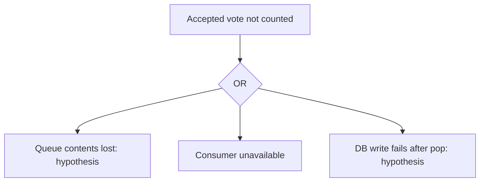

# ChaosPilot findings report

**Resilience score: 95/100 (grade A)**

Experiments run: 1. Stop reason: Single human-approved E1 validation; no fixes or further experiments.

## Executive summary

1 experiment records; resilience score 95/100 (grade A). E1: status aborted; recorded lost votes 0; stuck services [].

## Recon (before any attack)
Single points of failure: redis, db

- Hypothesis: If redis DNS resolution fails in GetIp, OpenRedisConnection does not retry it; Main returns exit code 1. Without a restart policy the worker stays down and accepted votes stop being processed. [FROM SOURCE; HYPOTHESIS] worker/Program.cs:62:             catch (Exception ex); worker/Program.cs:65:                 return 1;; worker/Program.cs:108:             var ipAddress = GetIp(hostname);; worker/Program.cs:118:                 catch (RedisConnectionException); worker/Program.cs:127:             => Dns.GetHostEntryAsync(hostname)
- Hypothesis: if redis crashes, its dependents recover on their own and no data is lost
- Hypothesis: if db crashes, its dependents recover on their own and no data is lost

## Weaknesses ranked by risk (FMEA)

| Rank | ID | Failure mode | Effect | S | O | D | RPN | Priority |
|---|---|---|---|---|---|---|---|---|
| 1 | E1 | kill redis | major outage (67% of requests failed) | 7 | 7 | 2 | 98 | Medium |

## Detection and recovery

MTTD/MTTR require Observer measurements. Legacy HTTP probe timings are shown separately; they do not prove end-to-end vote recovery.

| Experiment | MTTD | MTTR | First HTTP error | HTTP recovery after restoration |
|---|---|---|---|---|
| E1 | unknown / not measured | unknown / not measured | 0.5 s | 1.5 s |
Mean mttd_s: unknown / not measured; measured samples 0/1. Unknown/non-recovery observations are not zeros.
Mean mttr_s: unknown / not measured; measured samples 0/1. Unknown/non-recovery observations are not zeros.

### Per failure mode

| Fault / target | Mean MTTD | Samples | Mean MTTR | Samples |
|---|---|---|---|---|
| kill:redis | unknown / not measured | 0/1 | unknown / not measured | 0/1 |

## Fault tree: accepted vote not counted

Recorded aggregate loss: none recorded / insufficient evidence. This does not localise the loss mechanism.
Worker reported stuck: none recorded. Queue loss and DB-write branches need intervention evidence; no probabilities are assigned.

## Heatmap

The service × fault heatmap is in report.html. Combined experiments are labelled; untested cells remain unknown.
